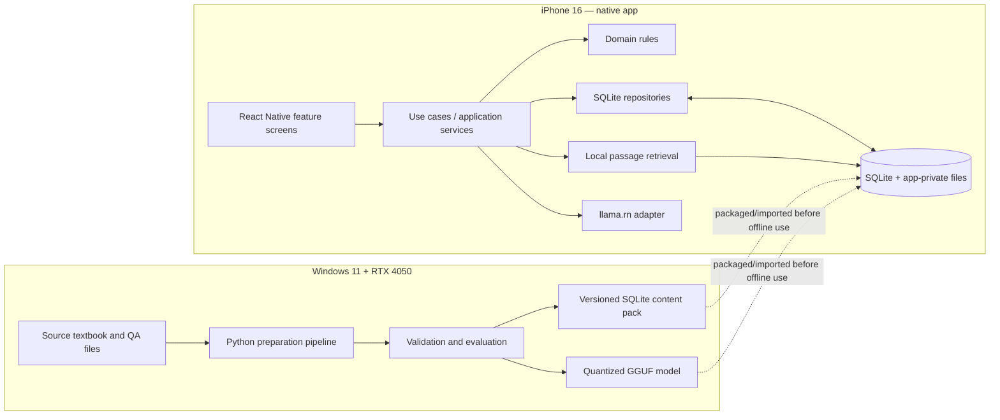

# AI Tutor — System Architecture

**Status:** Proposed baseline for implementation  
**Target:** iPhone 16, offline after installation/provisioning  
**Build host:** Windows 11 laptop, NVIDIA RTX 4050 6 GB VRAM, 24 GB RAM  
**Primary stack:** Python training utilities + Expo/React Native + `expo-sqlite` + `llama.rn`/`llama.cpp`  
**Principle:** simple operational core, strict contracts, optional AI capability, observable asset pipeline.

## 1. Goals and non-goals

### Goals

1. Run reviewer and local LLM inference on the iPhone without a remote backend.
2. Keep answer keys and official scoring deterministic and auditable.
3. Make every training/preparation stage independently executable and re-runnable.
4. Debug extraction, linkage, retrieval, model, data, and native runtime failures separately.
5. Track exactly which textbook/data/model/prompt/runtime versions produced a result.
6. Make growth possible through versioned contracts and adapters, not premature services or abstractions.
7. Support Windows-first development and keep Apple-specific signing/build concerns isolated from domain logic.

### Non-goals for MVP

- Training a foundation model from scratch.
- A server, account system, cloud sync, remote telemetry, or paid LLM API.
- Letting an LLM generate or modify official quiz answers.
- Requiring embeddings before basic search/reviewer features work.
- Guaranteeing a fixed generation time before benchmarking the exact model on the phone.

## 2. Quality attributes and invariants

- **Offline:** core use cases work with airplane mode enabled after the app, content pack, and model are provisioned.
- **Correctness:** answer-key grading is a deterministic function of the persisted canonical answer and normalized user response.
- **Explainability:** every AI explanation request carries question ID, content version, supporting passage IDs/page references, model ID, prompt template version, and outcome status.
- **Recovery:** interrupted setup/import does not leave a half-installed content pack or corrupt active database.
- **Reproducibility:** every pipeline stage records inputs, outputs, tool versions and hashes.
- **Privacy:** learner progress and diagnostics stay local by default; no prompt/response content is logged in normal mode.
- **Resource bounded:** only one LLM session at a time in MVP; bounded context/output; explicit cancel and release lifecycle.
- **Replaceability:** UI code does not import `llama.rn` directly; repository code does not import model implementation details.

## 3. System context



The dotted arrows represent an installation/provisioning transfer, not a runtime API call. Once provisioned, the iOS application must not depend on the Windows laptop.

## 4. Repository and package boundaries

```text
ai-tutor-app/
├── README.md
├── ARCHITECTURE.md
├── pyproject.toml                 # optional root task runner/config; no shared runtime
├── docs/
│   ├── architecture/
│   ├── adr/
│   └── runbooks/
├── contracts/                     # language-neutral JSON Schemas
├── scripts/
│   ├── setup_all.sh
│   ├── validate_contracts.py
│   ├── verify_artifacts.py
│   └── package_release.py
├── training/
│   ├── pyproject.toml
│   ├── configs/
│   │   ├── pipeline.yaml
│   │   └── model.yaml
│   ├── data/                      # raw/interim/processed, ignored by git
│   ├── artifacts/                 # stage outputs + manifests, ignored by git
│   ├── models/                    # downloaded/base/checkpoints/GGUF, ignored by git
│   ├── src/ai_tutor_training/
│   │   ├── stages/
│   │   │   ├── extract_textbook.py
│   │   │   ├── link_qa_pairs.py
│   │   │   ├── build_passages.py
│   │   │   ├── build_embeddings.py  # optional stage behind config flag
│   │   │   ├── train.py             # optional stage; not needed for baseline
│   │   │   └── export_gguf.py
│   │   ├── contracts/
│   │   ├── evaluation/
│   │   ├── provenance/
│   │   └── cli.py
│   └── tests/
├── mobile/
│   ├── app/                        # navigation/router only
│   ├── src/
│   │   ├── app/                    # composition root, app lifecycle
│   │   ├── domain/                 # types and pure business rules
│   │   ├── application/            # use cases and ports/interfaces
│   │   ├── features/
│   │   │   ├── review/
│   │   │   ├── quiz/
│   │   │   ├── explain/
│   │   │   ├── progress/
│   │   │   └── settings/
│   │   ├── data/
│   │   │   ├── sqlite/
│   │   │   │   ├── migrations/
│   │   │   │   ├── repositories/
│   │   │   │   └── importers/
│   │   │   └── content-pack/
│   │   ├── ai/
│   │   │   ├── ports/
│   │   │   ├── prompting/
│   │   │   ├── retrieval/
│   │   │   ├── runtime/
│   │   │   └── evaluation/
│   │   ├── diagnostics/
│   │   └── platform/
│   │       ├── filesystem/
│   │       └── lifecycle/
│   ├── assets/                      # only small app assets; model size decided explicitly
│   ├── scripts/
│   └── tests/
└── release/
    └── manifests/                  # signed/release metadata, not user data
```

This is a target map, not a requirement to create empty folders. Implement a folder when it contains a real responsibility. Avoid a second app-framework inside `src/` or putting domain rules in React components.

## 5. Runtime dependency rules

Enforce these import/dependency directions:

1. `features/**` may depend on `application/**` and UI components; it must not query SQLite directly or import `llama.rn`.
2. `application/**` orchestrates use cases and depends on domain types plus interfaces/ports.
3. `domain/**` contains pure logic; no React, Expo, SQLite, filesystem or model SDK imports.
4. `data/sqlite/**` implements question/progress repositories and database migrations.
5. `ai/runtime/**` is the only area that imports `llama.rn`.
6. `ai/retrieval/**` is the only area that queries passage search indexes.
7. `training/**` never imports mobile runtime modules. `mobile/**` never imports Python training code.
8. Build/signing code does not become part of quiz or AI business logic.

## 6. Mobile orchestration and use cases

### Core use cases

- `InitializeApp`: open/migrate database, verify content pack metadata, inspect model readiness; core review should still open if the model is absent or fails.
- `GetNextQuestion`: obtain eligible question(s) from repository, apply deterministic choice shuffling where permitted, record selection/session state.
- `SubmitAnswer`: compare normalized selected answer with canonical answer; persist attempt/result; return authoritative scoring result.
- `GetExplanationContext`: load canonical explanation and retrieve the best local passage(s) by exact passage link first, then lexical fallback.
- `ExplainMore`: validate evidence/context budget, ask `LocalLlmPort` to generate a bounded explanation, validate the output and attach source references.
- `InterpretFreeAnswer`: request a constrained structured interpretation; domain/application layer then compares interpreted answer candidate with canonical key and controls final score.
- `CancelGeneration`: cancel/ignore current generation and release resources safely.
- `CheckModelReadiness`: verify manifest, file exists, SHA-256, compatibility marker and free-space/availability before opening native runtime.
- `ExportDiagnostics`: create a user-triggered local diagnostics bundle without answer histories or prompt bodies unless separately opted in.

### Port interfaces (conceptual TypeScript)

```ts
export interface QuestionRepository {
  getQuestionById(id: string): Promise<Question | null>;
  getNextQuestions(query: QuestionSelectionQuery): Promise<Question[]>;
  recordAttempt(attempt: AnswerAttempt): Promise<void>;
}

export interface PassageRetriever {
  retrieve(query: RetrievalQuery): Promise<RetrievedPassage[]>;
}

export interface LocalLlmPort {
  getStatus(): Promise<ModelRuntimeStatus>;
  generate(request: GenerationRequest, signal?: AbortSignal): AsyncIterable<GenerationChunk>;
  release(): Promise<void>;
}

export interface ModelAssetStore {
  resolveVerifiedModel(manifestId: string): Promise<VerifiedModelAsset>;
}
```

Define concrete contracts in TypeScript and compile in CI/local checks. The above types show boundaries; they are not implemented APIs from `llama.rn`.

## 7. Data ownership and SQLite design

Keep content/reference data logically separate from learner activity. The bundled/installed content pack should be immutable during normal review. Progress is mutable and belongs in the local user database.

### Suggested entities

- `schema_migrations(version, applied_at, checksum)`
- `content_pack_metadata(pack_id, version, source_revision, imported_at, content_hash)`
- `topics(id, title, sort_order)`
- `passages(id, chapter, section, start_page, end_page, text, content_hash)`
- `questions(id, topic_id, question_type, stem, canonical_explanation, source_page, difficulty, content_version)`
- `choices(id, question_id, choice_key, text, sort_order)`
- `question_answers(question_id, canonical_choice_id)` or an equivalent constrained canonical answer representation
- `question_passages(question_id, passage_id, link_type, confidence, reviewer_status)`
- `study_sessions(id, started_at, ended_at, mode)`
- `answer_attempts(id, session_id, question_id, selected_choice_id, is_correct, answered_at, duration_ms)`
- `model_installations(id, manifest_id, sha256, status, installed_at)`
- `ai_run_summaries(id, question_id, model_id, prompt_version, status, duration_ms, retrieved_passage_ids_json, output_hash)`

Store full AI prompts, outputs, and typed free-text user answers only if a product requirement explicitly needs them. Default to minimal local telemetry. Use a migration for every schema change; never mutate the schema ad hoc in feature code.

### SQLite implementation rules

- Use `expo-sqlite`; use `npx expo install` so its version aligns with the project's Expo SDK.
- Use parameterized/prepared SQL for values derived from input. Never interpolate question text or user input into SQL strings.
- Enable foreign keys and define useful indexes (`questions.topic_id`, `choices.question_id`, `answer_attempts.question_id`, passage-link foreign keys).
- Use transactions for content imports, attempt recording when multi-table, and migrations.
- Use versioned migrations; test upgrade from the previous released schema.
- Consider FTS5 for initial lexical retrieval. Expo's current SQLite docs show FTS support and prepared-statement APIs; verify the installed SDK/config.
- Avoid `ORDER BY RANDOM()` across a very large question bank as the permanent selection strategy. Initially acceptable for a small dataset; benchmark it. For larger banks, select from a precomputed eligible-ID list or use an indexed deterministic/random-selection strategy.
- Treat content import as atomic: write to a staging database/table set, validate counts and checksums, then activate only after success.

## 8. Retrieval and prompt boundaries

### MVP retrieval order

1. Exact `question_passages` associations vetted during training/preparation.
2. FTS5 lexical search over passage text and section headings.
3. Optional vector retrieval only after a supported on-device query-embedding runtime is included and measured.

Important: offline precomputed passage vectors alone are insufficient for semantic search; the phone also needs a compatible way to embed the user's query. Treat `build_embeddings` as an optional pipeline stage until that mobile piece exists.

### Prompt builder

`PromptBuilder` is deterministic, versioned and independently unit-testable. It receives structured fields, not arbitrary UI fragments. It must include:

- instruction to use only supplied evidence and state when evidence is insufficient;
- the question, official answer and canonical explanation;
- the retrieved passage text and source page metadata;
- a bounded output length and stable format;
- explicit distinction between canonical facts and requested elaboration.

Treat textbook text and retrieved content as **data**, not instructions. If a passage contains instructions that conflict with the prompt, ignore those instructions. Do not put hidden chain-of-thought requirements in prompts; request a concise teaching explanation and supporting evidence instead.

### Output validation

- Prefer a human-readable explanation for `ExplainMore`.
- For `InterpretFreeAnswer`, define a JSON schema such as `{ "candidate_choice": "A|B|C|D|unknown", "confidence": 0.0, "evidence_passage_ids": ["..."] }` and validate it at runtime.
- Reject malformed JSON, unknown choice IDs, invalid confidence, and passage IDs not supplied to the generation.
- Low confidence or missing evidence must yield `unknown` / a request to compare the response manually, never an invented score.
- Final official correctness remains a deterministic comparison against the database key.

## 9. Model lifecycle and model manifest

Use a state machine rather than a global boolean:

`Missing → Verifying → Ready → Loading → Loaded → Generating → Loaded → Releasing → Ready`

Failure states should carry a typed reason (missing file, hash mismatch, unsupported model, native init failure, out-of-memory, cancellation). App navigation and standard quiz flow must remain usable when the model is unavailable.

### Model storage rules

- Store model files in the app-private persistent files area, resolved by a `ModelAssetStore` adapter.
- Do not hardcode a path copied from a simulator, Windows host, or `assets/` source location into inference calls.
- Verify SHA-256 before use. Use a temp filename during import and atomically rename after validation.
- Never overwrite a model that is currently loaded. Install the next version side-by-side, then switch the manifest pointer.
- Keep only the selected model installed by default; a model catalog can be added later.
- Bundle the model for truly offline first launch, or allow a one-time provisioning transfer/download before declaring the app ready. Clearly distinguish these policies in the release manifest.
- Test cold-start time, peak memory, generation speed, cancellation, backgrounding, thermal behavior and repeated load/release on a physical iPhone 16.

Example `model-manifest.json` fields are specified in `../contracts/model-manifest.schema.json`.

## 10. Training and data-preparation pipeline

The source scaffold describes the sequence:

`extract_textbook → link_qa_pairs → build_passages → build_embeddings → train → export_gguf`

That is **six** stages, not five. Preserve each as a standalone command with declared input and output contracts. Stages 4 and 5 are optional for MVP; stages 1–3 and content validation are the minimum viable data path.

| Stage | Responsibility | Output contract | Exit condition |
|---|---|---|---|
| `extract_textbook` | Extract text while preserving page/chapter metadata | `extracted_pages.jsonl` | Every row has source id/page and text or a reviewed empty-page reason |
| `link_qa_pairs` | Link each QA record to canonical answer/explanation/source references before chunking | `linked_questions.jsonl` | No unresolved critical answer links; uncertain links are explicitly flagged |
| `build_passages` | Create bounded, page-aware passages and stable passage IDs | `passages.jsonl` | Every passage retains provenance and stable ID |
| `build_embeddings` | Precompute passage vectors for optional semantic retrieval | `passage_embeddings.*` + manifest | Dimension/model/version match; disabled by default until mobile query embeddings are supported |
| `train` | Optional LoRA/QLoRA fine-tuning against curated tasks | checkpoint + dataset/training manifest | Held-out eval is at least as good as base model on agreed metrics |
| `export_gguf` | Convert/quantize compatible model and package manifest | `.gguf` + manifest + SHA-256 | Converted model runs locally and passes smoke/eval tests |

### Stage execution contract

Every stage must:

1. accept explicit input/output/config paths (no hidden current-working-directory assumptions);
2. validate inputs before doing expensive work;
3. write to a temporary output directory and publish only on success;
4. emit structured logs and a machine-readable run manifest;
5. record SHA-256 of input and output files, code revision, package versions, config hash and warnings;
6. produce deterministic outputs when the toolchain/config permits it;
7. fail with non-zero exit code and actionable diagnostics;
8. support re-running one stage without re-running prior stages.

Do not commit raw textbook files, checkpoints, GGUF models, extracted copyrighted content or personally sensitive progress into Git. Commit schemas, scripts, configs, tests, small synthetic fixtures and non-sensitive documentation.

### Training strategy

Start with a compatible, instruction-tuned pretrained model and RAG. Only implement LoRA/QLoRA if a held-out evaluation shows clear gaps that retrieval and prompt improvements do not solve. Six GB VRAM constrains training settings; begin with conservative micro-batches, short sequence lengths, gradient accumulation and a small model. Pin environment versions and record hardware/driver/CUDA versions in manifests. Do not make a training stage a prerequisite to making a working reviewer.

## 11. Observability and diagnostics

No server is required for observability. Produce structured **local** telemetry with opt-in export.

### Training-stage fields

`run_id`, `stage`, `started_at`, `ended_at`, `duration_ms`, `status`, `input_hashes`, `output_hashes`, `config_hash`, `git_revision`, `python_version`, key package versions, GPU name, warnings, error_code and error_summary.

### App-stage fields

`app_version`, `build_id`, `session_id`, `question_id`, `content_pack_version`, `model_manifest_id`, `prompt_version`, `retrieval_strategy`, retrieved passage IDs, load/generation durations, emitted token count, completion/cancel/failure status, normalized error code.

### Logging rules

- Use named levels: debug/info/warn/error.
- Normal mode logs metadata only; do not log full prompt, response or free-text answer by default.
- Debug mode must be explicit, local, time-bounded where feasible, and offer a delete/export action.
- Never log secrets, Apple credentials, signing material, full filesystem environment dumps or raw copyrighted source content.
- Maintain a bounded ring buffer and prevent logging from throwing into the user flow.
- Add stable error codes, e.g. `DB_MIGRATION_FAILED`, `CONTENT_HASH_MISMATCH`, `MODEL_NOT_FOUND`, `MODEL_HASH_MISMATCH`, `LLM_INIT_FAILED`, `LLM_OOM`, `LLM_CANCELLED`, `RETRIEVAL_EMPTY`, `INVALID_MODEL_OUTPUT`.

### Debug trace for an AI explanation

For each run, preserve a trace record like:

```json
{
  "runId": "run-local-uuid",
  "questionId": "q001",
  "contentPackVersion": "2026.10.1",
  "retrievalStrategy": "linked_then_fts5",
  "retrievedPassageIds": ["p001"],
  "modelManifestId": "local-model-001",
  "promptTemplateVersion": "explain-v1",
  "durationMs": 0,
  "status": "completed",
  "errorCode": null
}
```

This is a shape example; use real identifiers and actual measured durations at runtime.

## 12. Testing strategy

### Training pipeline

- Unit: extractor edge cases, text normalization, page boundary handling, ID stability, linkage confidence, passage overlap and contract validation.
- Integration: run each stage on synthetic fixtures; stage outputs must match schemas.
- Reproducibility: same inputs/config produce same content IDs and same output hashes where deterministic.
- Data quality gates: duplicate/empty questions, missing keys, invalid choice IDs, orphan passages, unresolved links, out-of-range pages, suspiciously identical train/eval samples.
- Model evaluation: held-out accuracy of constrained answer mapping, evidence-grounding checks, malformed JSON rate, refusal/unknown correctness, latency and token count.
- Export: test pre-export and quantized model on a fixed prompt suite with documented quality loss thresholds.

### Mobile app

- Unit: domain grading, answer normalization, question selection, prompt builder, response validator, state transitions.
- Repository integration: migrations, foreign keys, transaction rollback, content-pack swap, FTS queries, progress persistence after app restart.
- AI adapter: mock `llama.rn` for Jest unit tests; exercise native model integration in a physical-device smoke test. `llama.rn` documents a Jest mock path; reconcile it with the installed version.
- End-to-end: install clean build → open reviewer → answer question → save progress → request explanation → cancel generation → relaunch → confirm state remains correct.
- Offline: enable Airplane Mode, force-close/relaunch, use quiz, retrieve passage, invoke local model, and confirm no network dependency.
- Resilience: missing/corrupt model; hash mismatch; full disk; DB migration failure; low memory; backgrounding mid-generation; cancelled request; malformed model output.

### Performance

Measure on the actual iPhone 16 rather than asserting generic target numbers. Track p50/p95 cold model load, time-to-first-token, total generation latency, peak memory, app binary size, model file size, battery/thermal behavior and crash-free repeated runs. Establish budgets only after baseline measurements.

## 13. Security, licensing and privacy

- Use only models and datasets whose license and terms allow the planned personal use and redistribution method.
- Record base-model name/revision/license, fine-tuning dataset provenance, quantization method, conversion tool revision and model hash.
- Treat imported dataset and model files as untrusted until checksums and metadata are verified.
- Keep file writes within app-private locations; validate all import paths and reject path traversal.
- Do not include access tokens or signing credentials in source control or model manifests.
- Avoid collecting learner data remotely. If future sync is introduced, design it as a separate opt-in capability and do not compromise offline behavior.
- Do not claim encryption at rest unless it is configured and tested; decide separately whether app-private storage is enough or SQLCipher is required for the threat model.

## 14. Release architecture and delivery constraint

A release has two independently verifiable artifacts:

1. **Content/model release:** database pack, model GGUF, manifests, hashes, evaluation report.
2. **App release:** versioned iOS binary, app bundle identifier, native dependency lock, build profile, signing/distribution method, model/content inclusion policy and smoke-test report.

The release process should validate the artifacts first, then build/sign the iOS app, install on the physical device, and pass airplane-mode acceptance. Never let a successful Windows/Python training run imply that the iOS binary has been compiled or signed.

The native stack (`llama.rn`) requires a native iOS build, not Expo Go alone. Windows-first development can use an external build service for compilation, but physical-device installation still depends on the selected Apple signing/provisioning path. The zero-cost route is a delivery risk to validate early, not a responsibility of domain/application code.

## 15. Progressive implementation milestones

### M0 — Repository baseline

- Record current scaffold, actual SDK and package versions.
- Add this architecture and ADRs.
- Add `.gitignore`, synthetic test fixture and stage manifest format.
- Baseline `git status`, Python unit test and TypeScript check commands.

### M1 — Trustworthy data

- Complete extractor and linker.
- Validate contracts and unresolved link report.
- Build content DB pack with stable IDs and provenance.
- Add deterministic answer checking and reviewer UI without an LLM.

### M2 — Local search

- Add question-linked passage retrieval and FTS5 fallback.
- Show supporting page metadata.
- Test retrieval quality over fixed questions.

### M3 — Native local inference

- Choose one compatible small model by measured evaluation and license review.
- Integrate `llama.rn` behind `LocalLlmPort`.
- Implement model manifest, hash verification, bounded context/output, cancel/release lifecycle.
- Build and smoke-test on iPhone 16.

### M4 — Grounded explanations

- Add `ExplainMore` with prompt versioning, output validation and local run summaries.
- Keep official answer scoring independent.

### M5 — Optional improvements

- Add free-answer interpretation.
- Evaluate embeddings + on-device query embeddings.
- Fine-tune LoRA/QLoRA only if benchmark gains justify it.

### M6 — Release hardening

- Migrations/upgrade test, corrupt-asset recovery, offline tests, memory/latency/thermal measurements, reproducible release manifest and zero-cost signing path validation.

## 16. External technical references

Use official/current docs to validate the exact versions and APIs chosen at implementation time:

- Expo SQLite: https://docs.expo.dev/versions/latest/sdk/sqlite/
- `llama.rn` and Expo config: https://github.com/mybigday/llama.rn
- `llama.cpp` model conversion/quantization: https://github.com/ggml-org/llama.cpp/tree/master/docs
- Expo EAS Build: https://docs.expo.dev/build/introduction/
- Expo development builds: https://docs.expo.dev/develop/development-builds/introduction/
- Hugging Face PEFT: https://huggingface.co/docs/peft/index

Avoid pinning a generic “latest” version from this document. Resolve and commit compatible exact versions in each package lockfile after native compatibility tests.
