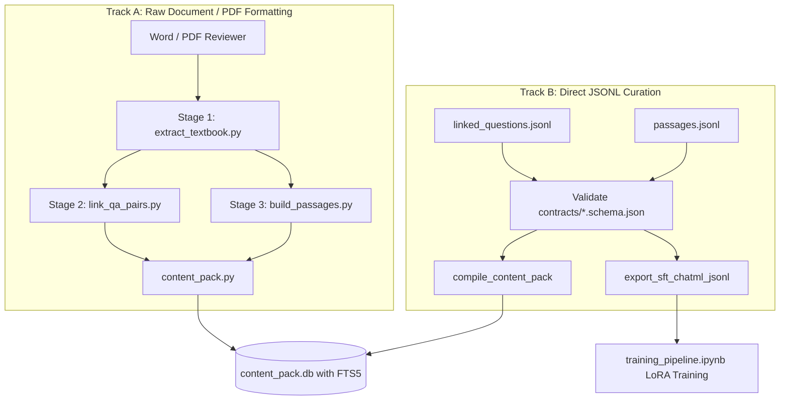

# Philippine Civil Service Exam Tutor — Dataset Arrangement & Schema Guide

**Target Repository:** [`D:\MobileApp Rag`](file:///d:/MobileApp%20Rag)  
**Applicable Packages:** `ai-tutor-training` (`training/`) and `ai-tutor-mobile` (`mobile/`)  
**Pipeline Standard:** Zero-Hallucination Deterministic Core + 3-Tier Progressive Iterative RAG  

---

## 1. Executive Summary: The Zero-Hallucination Data Design

In the `MobileApp Rag` architecture, the artificial intelligence model **never** scores questions or invents canonical answer keys. Instead, the system splits into two strict halves:

1. **The Deterministic Core (100% Auditable, 0% AI)**:
   - All questions, choices, answer keys, and source page numbers are parsed directly from authentic reviewer materials using strict regex grammar.
   - All textbook passages are sentence-chunked (300 words max, 50-word overlap) with an **Abbreviation Shield** protecting legal citations (e.g. `R.A. 6713`, `Sec.`, `Art.`).
   - All compiled data is stored in a versioned SQLite database (`content_pack.db`) featuring an **External-Content FTS5 virtual table** (`passages_fts`) for sub-millisecond BM25 keyword retrieval.
2. **The Pedagogical AI Layer (Local Grounded LLM)**:
   - Evaluates free-text answers (**InterpretFreeAnswer**) against official JSON schemas.
   - Provides step-by-step pedagogical explanations (**ExplainMore**) strictly citing verified textbook page numbers (`[Page X]`).

---

## 2. Supported Ingestion Tracks

Depending on your source material, you can supply your dataset using either **Track A (Raw Reviewer Documents/PDFs)** or **Track B (Structured JSONL Curation)**:



---

## 3. Track A: Rules for Arranging Raw PDF / Word Documents

If formatting source text in Word, Google Docs, or compiling a PDF to place in `training/data/raw/reviewer.pdf`:

### Rule 1: Single-Column Layout Strictly Required
- **Mandatory Invariant**: Never use newspaper-style multi-column layouts (2 or 3 columns per page).
- **Reason**: Multi-column text with vertical gutters causes optical bounding boxes to interleave choice letters between adjacent columns, corrupting extracted questions.

### Rule 2: Chapter & Section Heading Grammar
The pipeline tracks current subject context across page turns using regular expressions configured in [`training/configs/pipeline.yaml`](file:///d:/MobileApp%20Rag/training/configs/pipeline.yaml):
```text
CHAPTER 1: General Information
Section: 1987 Philippine Constitution

KABANATA 2: Talasalitaan
Seksyon: Mga Salitang Magkasingkahulugan

PART 3: Numerical Ability
Section: Word Problems and Percentage
```

### Rule 3: Question & Choice Grammar
- Each question must start on a new line with a number followed by a period or parenthesis: `1. `, `2. `, or `Question 1: `.
- Choices can have 4 options (`a.` through `d.`) or 5 options (`a.` through `e.`).
- Every choice must be placed on its own line:
```text
1. Where does sovereignty reside according to the 1987 Constitution?
A. In the Armed Forces of the Philippines
B. In the President and the Cabinet
C. In the people, and all government authority emanates from them
D. In the Supreme Court
```

### Rule 4: Explanations (Inline vs. End-of-Chapter Answer Key)
- **Inline Explanations (Recommended)**: Place an `Explanation:` block immediately beneath choices:
  ```text
  Explanation: Choice (c) "In the people, and all government authority emanates from them" is correct because Article II, Section 1 declares that sovereignty resides in the people... Choice (a) is incorrect because...
  ```
- **End-of-Chapter Answer Key**:
  ```text
  ANSWER KEY:
  1 - C
  2 - B
  3 - A
  ```

---

## 4. Track B: Rules for Arranging Structured JSON / JSONL Data

If curating questions and passages directly into JSONL files:

### A. Question Schema ([`contracts/linked-question.schema.json`](file:///d:/MobileApp%20Rag/contracts/linked-question.schema.json))
File location: [`training/artifacts/linked_questions.jsonl`](file:///d:/MobileApp%20Rag/training/artifacts/linked_questions.jsonl)

| Field | Type | Required? | Constraints & Description |
| :--- | :--- | :---: | :--- |
| `question_id` | String | **Yes** | Pattern: `^q[0-9]{4,}$` (e.g. `"q0001"`, `"q0042"`). |
| `topic` | String | **Yes** | Subject or chapter name (e.g. `"Vocabulary"`, `"Constitution"`). |
| `question_type` | String | **Yes** | Enum: `"multiple_choice"`, `"identification"`, `"essay"`. |
| `stem` | String | **Yes** | The complete question text. |
| `choices` | Array | Conditional | Required for `"multiple_choice"`. Array of `{"key": "A", "text": "..."}`. |
| `canonical_answer` | String | Optional | The verbatim correct answer string. |
| `canonical_choice_key` | String | Optional | The correct choice letter (e.g. `"A"`, `"B"`, `"C"`, `"D"`, `"E"`). |
| `canonical_explanation` | String | Optional | Official pedagogical explanation or citation note. |
| `source_page` | Integer | **Yes** | Minimum: `1`. The textbook page where the item appears. |
| `difficulty` | String | Optional | Enum: `"easy"`, `"medium"`, `"hard"`. |
| `link_confidence` | String | **Yes** | Enum: `"verified"`, `"high"`, `"low"`, `"unresolved"`. |
| `content_version` | String | Optional | Release version string (e.g. `"2026.10.1"`). |

#### Complete Question JSON Example:
```json
{
  "question_id": "q0001",
  "topic": "Context Clues - Synonyms",
  "question_type": "multiple_choice",
  "stem": "The Vice-President's act was absolutely treacherous for the Filipinos.",
  "choices": [
    {"key": "a", "text": "betrayal"},
    {"key": "b", "text": "hazardous"},
    {"key": "c", "text": "harmless"},
    {"key": "d", "text": "commendable"},
    {"key": "e", "text": "secured"}
  ],
  "canonical_answer": "betrayal",
  "canonical_choice_key": "a",
  "canonical_explanation": "Choice (a) \"betrayal\" is correct because \"treacherous\" means guilty of or involving betrayal or deception.",
  "source_page": 1,
  "difficulty": "medium",
  "link_confidence": "verified",
  "content_version": "2026.10.1"
}
```

---

### B. Passage Schema ([`contracts/passage.schema.json`](file:///d:/MobileApp%20Rag/contracts/passage.schema.json))
File location: [`training/artifacts/passages.jsonl`](file:///d:/MobileApp%20Rag/training/artifacts/passages.jsonl)

| Field | Type | Required? | Constraints & Description |
| :--- | :--- | :---: | :--- |
| `passage_id` | String | **Yes** | Pattern: `^p[0-9]{4,}$` (e.g. `"p0001"`). |
| `chapter` | String | **Yes** | Top-level subject area (e.g. `"General Information"`). |
| `section` | String | Optional | Sub-topic or section title. |
| `start_page` | Integer | **Yes** | Starting 1-based page number. |
| `end_page` | Integer | **Yes** | Ending 1-based page number. |
| `text` | String | **Yes** | Clean, non-empty excerpt text for BM25 retrieval. |
| `content_hash` | String | **Yes** | SHA-256 hexadecimal hash of `text` (64 characters). |
| `word_count` | Integer | Optional | Number of words in passage (ideally 200–350 words). |

#### Complete Passage JSON Example:
```json
{
  "passage_id": "p0001",
  "chapter": "General Information",
  "section": "1987 Philippine Constitution",
  "start_page": 12,
  "end_page": 12,
  "text": "The Philippines is a democratic and republican State. Sovereignty resides in the people and all government authority emanates from them. The State values the dignity of every human person and guarantees full respect for human rights.",
  "content_hash": "e3b0c44298fc1c149afbf4c8996fb92427ae41e4649b934ca495991b7852b855",
  "word_count": 36
}
```

---

### C. ChatML SFT Training Format (Stage 5 LoRA)
File location: [`training/artifacts/reviewer_sft_chatml.jsonl`](file:///d:/MobileApp%20Rag/training/artifacts/reviewer_sft_chatml.jsonl)

Each record must have a 3-turn message conversation:
1. `role: "system"`: System prompt declaring pedagogical tutor rules.
2. `role: "user"`: User prompt wrapping background passage in `<context>` and question/choices in `<task>`.
3. `role: "assistant"`: Grounded answer justification citing source page (`[Page X]`).

---

## 5. Subject-by-Subject Problem Archetypes

### 1. English & Filipino Verbal Ability
- **Format**: 5 choices (`a.` through `e.`) with inline pedagogical explanation.
- **Topics**: Synonyms, Antonyms, Context Clues, Wastong Gamit, Reading Comprehension.

### 2. General Information (Constitution & R.A. 6713)
- **Format**: 4 choices (`A.` through `D.`), direct legal citation in explanation.
- **Topics**: National Territory, Bill of Rights, Citizenship, Executive, Legislative, Judicial, Constitutional Commissions, SALN rules.

### 3. Numerical Ability (Mathematics)
- **Format**: 4 choices with step-by-step arithmetic derivation in explanation.
- **Topics**: Percentages, Fractions, Ratio & Proportion, Word Problems (Speed, Work, Age, Interest).

### 4. Analytical Ability
- **Format**: Word analogies (`A : B :: C : D`) and categorical syllogisms.

---

## 6. How to Validate & Ingest Your Data

### Step 1: Programmatic Validation & Content Pack Compilation
Run the automated live preparation script:
```powershell
python training/scripts/annotate_and_prepare_training.py --mode live
```
This executes:
1. Schema validation against official JSON schemas.
2. SQLite database compilation to `training/artifacts/content_pack.db`.
3. FTS5 BM25 search index creation.
4. Grounded RAG ChatML dataset export.

### Step 2: Automated Contract Conformance Test
Run the automated pytest test suite:
```powershell
python -m pytest training/tests/test_reviewer_ingestion.py -v
```

### Step 3: Stage 5 GPU LoRA Fine-Tuning
Open [`training/notebooks/training_pipeline.ipynb`](file:///d:/MobileApp%20Rag/training/notebooks/training_pipeline.ipynb) and run all 10 stages to train the model on your local RTX 4050 GPU!
