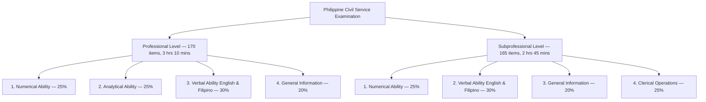
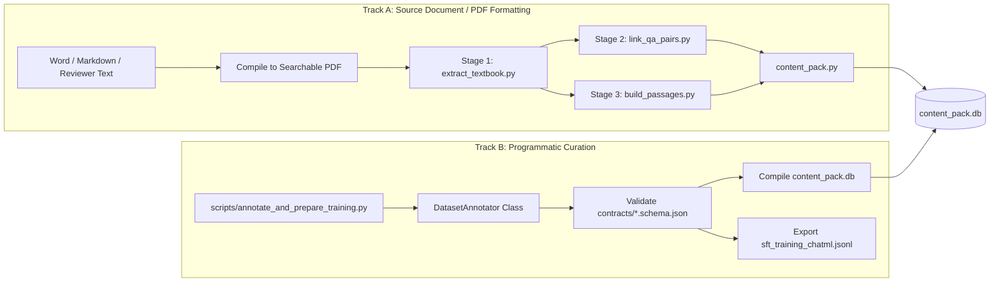

# Philippine Civil Service Exam Reviewer: Data Annotation & PDF Formatting Specification

**Document Version:** `1.0.0`  
**Target Repository:** [`D:\MobileApp Rag`](file:///d:/MobileApp%20Rag)  
**Applicable Packages:** `ai-tutor-training` (`training/`) and `ai-tutor-mobile` (`mobile/`)  
**Pipeline Engine:** PyMuPDF 1.25.0+, SQLite FTS5 BM25, Click CLI, ChatML SFT Generator  
**Standard Basis:** Official Civil Service Commission (CSC) Career Service Examination Syllabus (Professional & Subprofessional Levels)

---

## 1. Executive Summary & Objective

The **Offline Civil Service AI Tutor** relies on a **Zero-Hallucination Deterministic Core**:
1. All exam questions, multiple-choice options, canonical answers, and official explanations are parsed deterministically from textbook materials using regular expression state machines (`extract_textbook.py`, `link_qa_pairs.py`).
2. All textbook background explanations are chunked into 300-word passages and indexed in an external-content **SQLite FTS5 virtual table** (`passages_fts`) with sub-2ms BM25 ranking.
3. The local on-device LLM (`Qwen3-1.7B`) is strictly restricted to providing pedagogical explanations (**Feature A: ExplainMore**) and evaluating semantic equivalence of free-form identification/essay answers (**Feature B: InterpretFreeAnswer**).

To guarantee **100% extraction accuracy, zero dropped questions, and clean model fine-tuning (SFT/LoRA)**, source PDF documents or digitized study texts must adhere to the structural conventions, heading hierarchies, problem layouts, and answer key formats defined in this specification.

---

## 2. Official Exam Syllabus & Curriculum Basis

The Philippine Civil Service Examination is administered in two levels. The pipeline is designed to ingest and categorize both levels across 5 core subject domains:



### 2.1 Subject Domain Breakdown & Scope

| Domain Code | Subject Title | Official CSC Scope & Problem Archetypes |
| :--- | :--- | :--- |
| `numerical-ability` | **Numerical Ability** | Basic mathematical operations, fractions, decimals, percentages, ratio & proportion, algebra, and word problems (speed/distance/time, age, work, interest). |
| `analytical-ability` | **Analytical Ability** *(Prof only)* | Word association, single and double word analogies, logical deduction, categorical syllogisms, and data interpretation (tables, bar charts, line graphs). |
| `verbal-ability` | **Verbal Ability** | English and Filipino vocabulary (synonyms, antonyms, context clues), grammar and correct usage (*wastong gamit*, subject-verb agreement), sentence correction, paragraph organization, and reading comprehension (*pag-unawa sa binasa*). |
| `general-information` | **General Information** | **1987 Philippine Constitution** (Preamble, National Territory, Bill of Rights, Citizenship, Executive, Legislative, Judicial, Constitutional Commissions), **Republic Act No. 6713** (Code of Conduct and Ethical Standards for Public Officials and Employees), Peace and Human Rights Concepts, and Environmental Management/Protection. |
| `clerical-operations` | **Clerical Operations** *(Subprof only)* | Alphabetizing and filing rules (Library of Congress / ARMA standards), clerical reasoning, spelling, and office procedures. |

---

## 3. The Two Data Annotation Tracks

Depending on your workflow, you can provide study data using either **Track A (Source PDF Ingestion)** or **Track B (Programmatic JSONL Curation)**:



- **Track A (Recommended for Existing Reviewer Books)**: Format raw text or PDFs using the heading, item, and answer key regex grammar in Section 4. The pipeline extracts, links, and builds SQLite packages automatically.
- **Track B (Recommended for Curated SFT / LoRA Datasets)**: Use the [`DatasetAnnotator`](file:///d:/MobileApp%20Rag/training/src/ai_tutor_training/annotation.py) Python API to programmatically insert questions and passages with instant schema validation and ChatML export.

---

## 4. Document Typography & Layout Grammar (Track A)

### 4.1 Document Geometry & Page Setup
1. **Single-Column Layout Strictly Required**: Do **not** use newspaper-style multi-column text (e.g. 2 columns per page). PyMuPDF extracts text in reading-order blocks, but multi-column text with inconsistent vertical gutters can interleave choices between questions.
2. **Text Encoding**: Must be true, searchable vector text (UTF-8). Scanned bitmap PDFs without OCR will produce 0 extracted characters.
3. **Margins & Spacing**: Standard 1-inch (72pt) margins. Maintain standard `1.15` to `1.5` line spacing.
4. **Header / Footer Isolation**: Page numbers should be placed at the bottom center or bottom right. Keep headers minimal (e.g. book title) to avoid polluting extracted passage sentences.

---

### 4.2 Heading Hierarchy & State Machine Patterns

The Stage 1 extractor ([`extract_textbook.py`](file:///d:/MobileApp%20Rag/training/src/ai_tutor_training/stages/extract_textbook.py)) tracks current chapter and section context across page turns using regex patterns declared in [`training/configs/pipeline.yaml`](file:///d:/MobileApp%20Rag/training/configs/pipeline.yaml):

```text
CHAPTER HEADING (Level 1)
   └── SECTION HEADING (Level 2)
          ├── READING EXCERPTS / THEORY (Passage Chunking)
          ├── PRACTICE QUESTIONS (Pass 2 Question Parser)
          └── ANSWER KEY & RATIONALES (Pass 1 Answer Key Parser)
```

#### Level 1: Chapter / Major Domain Headings
Every new subject or major chapter must begin on a new page with a recognized Level 1 heading:

```text
Acceptable English Patterns:
  CHAPTER 1: Philippine Constitution
  Chapter I - General Information
  PART 2: Verbal Ability (English & Filipino)
  NUMERICAL ABILITY
  ANALYTICAL ABILITY
  CLERICAL OPERATIONS

Acceptable Filipino Patterns:
  KABANATA 1: Saligang Batas ng 1987
  Kabanata IV - Wastong Gamit ng mga Salita
  BAHAGI 3: Kakayahang Berbal
```

*Regex Matching Rule:*
```regex
^(?:CHAPTER|Chapter|KABANATA|Kabanata|PART|Part|BAHAGI|Bahagi)\s+[\dIVXLCDM]+[.:-]?\s*(.*)
^(?:ENGLISH|MATH|FILIPINO|GENERAL\s+(?:INFORMATION|LAWS?)|CLERICAL\s+OPERATIONS|NUMERICAL\s+ABILITY|VERBAL\s+ABILITY|ANALYTICAL\s+ABILITY)
```

#### Level 2: Section / Subtopic Headings
Subtopics inside a chapter should use Level 2 headings:

```text
Acceptable Patterns:
  Section 1: Bill of Rights (Article III)
  Seksyon 2: Paggamit ng "ng" at "nang"
  Section: Fractions and Percentages
  Section: Word Analogy and Association
```

*Regex Matching Rule:*
```regex
^(?:Section|Seksyon)(?:\s+[\dIVXLCDM]+)?[.:-]?\s*(.*)
```

---

## 5. Problem Type Specifications & Copy-Pasteable Templates

### 5.1 Problem Type 1: Standard Multiple Choice (4 Choices A–D)

**Use For:** Numerical, Analytical, Verbal, Constitution, Clerical.

#### Formatting Rules:
1. Question number must start on its own line: `1. `, `2. `, or `Question 1: `.
2. Question stem must clearly state the question or complete-the-blank prompt.
3. Choices must start on new lines with capital letters followed by a period or parenthesis: `A.`, `B.`, `C.`, `D.` (or `(A)`, `[A]`).
4. Keep choice text on the same indented block. Do not place choices side-by-side on the same line (e.g. avoid `A. 10   B. 20   C. 30   D. 40`).

#### Document Template:
```text
CHAPTER 1: General Information
Section: 1987 Philippine Constitution

1. According to Article II, Section 1 of the 1987 Constitution, where does sovereignty reside?
A. In the Armed Forces of the Philippines
B. In the President and the Cabinet
C. In the people, and all government authority emanates from them
D. In the Supreme Court of the Philippines

2. Alin sa mga sumusunod ang pangunahing tungkulin ng Pamahalaan ayon sa Artikulo II, Seksyon 4?
A. Magpatupad ng mataas na buwis
B. Maglingkod at pangalagaan ang sambayanan
C. Makipag-ugnayan sa dayuhang sandatahan
D. Magtayo ng mga pribadong korporasyon
```

---

### 5.2 Problem Type 2: Reading Comprehension & Stimulus-Dependent Questions

**Use For:** Verbal Ability (English & Filipino reading passages with 3 to 5 dependent questions).

#### Formatting Rules:
1. **Passage Stimulus Bounding**: Precede reading passages with a standard CSC directions header:
   `Directions: Read the passage below carefully and answer Questions X to Y that follow.`
2. **Optional Semantic Delimiter**: You may optionally wrap the excerpt in `[PASSAGE: <Title>]` and `[/PASSAGE]` to guarantee that Stage 3 treats the entire stimulus as an unbroken semantic unit.
3. **Numbered Dependent Questions**: Follow immediately with standard numbered multiple-choice questions.

#### Document Template:
```text
CHAPTER 2: Verbal Ability
Section: Reading Comprehension

Directions: Read the following selection carefully and answer Questions 3 to 5:

[PASSAGE: Public Accountability under R.A. 6713]
Public officials and employees shall at all times be accountable to the people, serve them with utmost responsibility, integrity, loyalty, and efficiency, act with patriotism and justice, and lead modest lives. Republic Act No. 6713 establishes that public office is a public trust. Civil servants are required to submit their Statement of Assets, Liabilities, and Net Worth (SALN) within thirty (30) days after assumption of office.
[/PASSAGE]

3. What is the fundamental mandate imposed on public officials by Republic Act No. 6713?
A. To accumulate personal investments while in office
B. To treat public office as a public trust and remain accountable to the people
C. To report exclusively to the Executive Secretary
D. To prioritize commercial interests in public transactions

4. Within how many days after assumption of office must a public official file their SALN?
A. 15 days
B. 30 days
C. 60 days
D. 90 days

5. Ano ang pangunahing mensahe ng seleksyon ukol sa pamumuhay ng mga lingkod-bayan?
A. Mamuhay nang marangya upang maging huwaran
B. Mamuhay nang payak at may integridad sa lahat ng pagkakataon
C. Umiwas sa pagsumite ng ulat ng ari-arian
D. Tanggapin ang anumang regalo mula sa mga kliyente
```

---

### 5.3 Problem Type 3: Verbal Analogy & Word Association

**Use For:** Analytical Ability.

#### Formatting Rules:
1. Use standard paired analogy punctuation: `CONCEPT A : CONCEPT B :: CONCEPT C : _______`
2. Provide 4 clean lettered choices.

#### Document Template:
```text
CHAPTER 3: Analytical Ability
Section: Word Analogy

6. LEGISLATIVE : LAWS :: JUDICIAL : _______
A. Enforce policies
B. Interpret laws
C. Collect taxes
D. Conduct audits

7. PANGULO : EHEKUTIBO :: KONGRESO : _______
A. Hudisyal
B. Lehislatibo
C. Komisyon sa Halalan
D. Sandiganbayan
```

---

### 5.4 Problem Type 4: Numerical Ability & Mathematical Word Problems

**Use For:** Math, Word Problems, Percentage, Ratio, Financial Reasoning.

#### Formatting Rules:
1. Write numeric quantities with unambiguous units (e.g. `₱15,000`, `45 km/h`, `3 hours`).
2. Fractions should be formatted clearly: `1/2`, `3/4`, or spelled out if inline.
3. Every math problem **must** be accompanied by a step-by-step mathematical derivation in the **Answer Key** section so our pipeline extracts the canonical solution for on-device tutoring.

#### Document Template:
```text
CHAPTER 4: Numerical Ability
Section: Word Problems and Percentage

8. An employee's basic monthly salary increased from ₱20,000 to ₱25,000. What is the percentage increase?
A. 20%
B. 25%
C. 30%
D. 50%

9. A water tank can be filled by Pipe A in 4 hours and emptied by Pipe B in 6 hours. If both pipes are opened simultaneously, how many hours will it take to fill the empty tank?
A. 10 hours
B. 12 hours
C. 14 hours
D. 24 hours
```

---

### 5.5 Problem Type 5: Identification (Direct Legal Citation / Factual Recall)

**Use For:** General Information (Constitutional provisions, Republic Act numbers, Official titles).

#### Formatting Rules:
1. In the question stem, omit multiple-choice options (`A-D`).
2. Use question phrases like `Identify...`, `Name the Republic Act...`, `Ano ang tawag sa...`.
3. The answer key must provide the exact canonical term (e.g. `Republic Act 6713` or `Ombudsman`).

#### Document Template:
```text
CHAPTER 5: General Information
Section: Accountability of Public Officers

10. Identify the independent constitutional body tasked to investigate any civil servant, employee, office or agency for graft, corruption, or injustice.

11. Anong Republic Act ang kilala bilang Code of Conduct and Ethical Standards for Public Officials and Employees?
```

---

### 5.6 Problem Type 6: Conceptual Essay / Short-Answer (Rubric Scored)

**Use For:** Comprehensive review items scored via Feature B (**InterpretFreeAnswer**).

#### Formatting Rules:
1. Question stem begins with an action verb: `Explain...`, `Discuss...`, `Enumerate...`, `Ipaliwanag...`, `Talakayin...`.
2. Do not include choices.
3. The Answer Key must provide the canonical explanation and key rubric concepts (e.g. Key Concept 1, Key Concept 2) for semantic evaluation.

#### Document Template:
```text
CHAPTER 6: Civil Service Law
Section: Principles of Merit and Fitness

12. Explain the Constitutional principle of the Merit and Fitness System in the Philippine Civil Service and identify which appointments are exempted from competitive examination.

13. Ipaliwanag ang kahalagahan ng Bill of Rights sa Saligang Batas ng 1987 bilang proteksyon ng mamamayan laban sa pang-aabuso ng kapangyarihan ng estado.
```

---

### 5.7 Problem Type 7: 5-Choice Multiple Choice with Inline Pedagogical Explanations

**Use For:** English Vocabulary, Synonyms, Antonyms, Context Clues, and General Information.

#### Formatting Rules:
1. Provide 5 choices (`a.` through `e.` or `A.` through `E.`) on separate lines.
2. Directly beneath the choices, include an `Explanation:` or `Paliwanag:` block.
3. The explanation **must** state the correct letter in parentheses (e.g. `Choice (a) "..." is correct because...`), followed by pedagogical refutations of incorrect distractors.
4. The Stage 2 parser automatically extracts both the verified canonical answer and the full explanation without requiring a separate end-of-chapter answer key.

#### Document Template:
```text
Context Clues - Synonyms
Directions: Choose the letter corresponding to the word which has the CLOSEST meaning with the underlined word.

1. The Vice-President's act was absolutely treacherous for the Filipinos.
a. betrayal
b. hazardous
c. harmless
d. commendable
e. secured
Explanation: Choice (a) "betrayal" is correct because "treacherous" means guilty of or involving betrayal or deception. Choice (b) "hazardous" is incorrect because it means risky or dangerous, which refers to physical safety rather than disloyalty. Choice (c) "harmless" is incorrect as it is an antonym meaning incapable of causing harm. Choice (d) "commendable" is incorrect as it means deserving praise, which contradicts the negative connotation of treacherous. Choice (e) "secured" is incorrect because it means fixed or protected, which has no lexical overlap with deceit or betrayal.
```

---

## 6. Answer Key & Explanation Layout Grammar

The Stage 2 parser ([`link_qa_pairs.py`](file:///d:/MobileApp%20Rag/training/src/ai_tutor_training/stages/link_qa_pairs.py)) supports two flexible ingestion models:
- **Model A (Inline Explanations)**: Explanations immediately follow each question's choices (`Explanation: Choice (X)...`).
- **Model B (End-of-Chapter Answer Keys)**: Dedicated answer key tables placed at the end of each chapter or section.

### 6.1 Answer Key Section Headers
Place answer keys at the end of each chapter or section. Use one of these recognized headers:

```text
Acceptable English Headers:
  Answer Key
  Answer Key and Explanations
  Correct Answers and Rationales

Acceptable Filipino Headers:
  Susi sa Pagwawasto
  Mga Tamang Sagot at Paliwanag
```

*Regex Matching Rule:*
```regex
(?i)(?:answer\s+key|susi\s+sa\s+pagwawasto|mga\s+tamang\s+sagot|correct\s+answers)
```

---

### 6.2 Item Layout Syntax: Multiple Choice with Rationales

Every answer key line must specify the question number, a separator (`.`, `-`, or `:`), the capital choice letter, and the **official rationale**:

#### Format 1: Dot Separator with Dash Rationale (Recommended)
```text
Answer Key and Explanations

1. C — Article II, Section 1 states that sovereignty resides in the people and all government authority emanates from them.
2. B — Article II, Section 4 declares that the prime duty of the Government is to serve and protect the people.
3. B — R.A. 6713 establishes public office as a public trust.
4. B — Section 8 requires filing within 30 days after assumption of office.
5. B — Ang mga kawani ng pamahalaan ay inaatasan na mamuhay nang payak at may integridad.
6. B — The judicial branch interprets laws, while the legislative enacts them.
7. B — Ang Kongreso ang may hawak ng kapangyarihang lehislatibo.
```

#### Format 2: Dash Separator with Colon
```text
Answer Key

8 - B: Solution: Percentage increase = ((25,000 - 20,000) / 20,000) * 100 = (5,000 / 20,000) * 100 = 25%.
9 - B: Solution: Rate per hour = (1/4) - (1/6) = (3/12) - (2/12) = 1/12 of the tank per hour. Time = 12 hours.
```

#### Format 3: Identification & Essay Rationales
```text
10. Office of the Ombudsman — Article XI, Section 12 designates the Ombudsman as the Protectors of the People.
11. Republic Act 6713 — Code of Conduct and Ethical Standards for Public Officials and Employees.
12. Merit and Fitness Principle — Article IX-B, Section 2(2) mandates appointments according to merit and fitness determined by competitive exams, except positions which are policy-determining, primarily confidential, or highly technical.
13. Proteksyon ng Karapatan — Ang Bill of Rights (Artikulo III) ay nagtatakda ng mga limitasyon sa kapangyarihan ng estado upang maiwasan ang di-makatarungang pag-aresto at paglabag sa kalayaan.
```

---

### 6.3 Multi-Page Answer Key Continuation Rules
If an answer key spans across multiple pages (e.g. Questions 1–50 on Page 90, and Questions 51–100 on Page 91):
1. **Do NOT insert new Chapter or Section headings** between the two answer key pages.
2. The pipeline's multi-page state machine will automatically continue parsing items until an explicit new Chapter header or question stem is encountered.
3. You may optionally repeat the header as `Answer Key (Continued)` on the next page.

---

## 7. Common PDF Formatting Pitfalls & Solutions

| Pitfall | Problem Description | Pipeline Consequence | Solution |
| :--- | :--- | :--- | :--- |
| **Two-Column Text** | Text laid out in 2 vertical columns per page. | PyMuPDF text stream may interleave lines between column 1 and column 2, mixing up choices. | Always export PDFs in **Single-Column layout**. |
| **Merged Choice Letters** | Choice text immediately touches the letter (e.g. `A.Taxes` or `A)Taxes`). | Regex `^\s*([A-Da-d])[.)]\s+(.*)` fails to match. | Ensure at least **one space** after the letter delimiter (`A. Taxes`). |
| **Side-by-Side Choices** | Putting `A. 10  B. 20  C. 30  D. 40` on one line. | Extractor treats the entire line as Choice A, dropping B, C, and D. | Place **each choice on its own line**. |
| **Scanned Raster PDF** | PDF generated by scanner as an image without OCR. | Extractor gets empty string (`""`), raising `CorruptSourceError`. | Always export directly from Word/Docs, or apply OCR before processing. |
| **Orphaned Numbers** | Question number separated from stem by a hard page break. | Parser marks item as unresolved or empty stem. | Ensure question number and stem start on the same page. |
| **Roman Numeral Conflicts** | Using `I.`, `V.`, `X.` for multiple-choice options. | Collides with Chapter Roman numerals (`CHAPTER IV`). | Use standard letters `A.`, `B.`, `C.`, `D.` for options; reserve Roman numerals for Chapter headings or sub-clauses inside the stem. |

---

## 8. Authoring Pre-Flight Checklist

Before submitting a reviewer PDF to the automated pipeline, verify against this 8-point checklist:

- [ ] **1. Single-Column Layout**: Document is strictly single-column throughout all pages.
- [ ] **2. Searchable Text**: Text can be highlighted, selected, and copied in a PDF viewer.
- [ ] **3. Recognized Level 1 Headings**: Every major subject starts with `CHAPTER X: <Title>` or a recognized subject title.
- [ ] **4. 4 Choices Per Multiple-Choice Item**: Every multiple-choice question has exactly choices `A`, `B`, `C`, and `D` on separate lines.
- [ ] **5. Bounded Reading Stimuli**: Reading passages include the `Directions: Read...` directive and optional `[PASSAGE]` markers.
- [ ] **6. Answer Key Presence**: An `Answer Key` section is present at the end of each chapter.
- [ ] **7. Question Number Parity**: The numbers in the answer key strictly match the question numbers in the practice exercises (1:1 parity).
- [ ] **8. Canonical Explanations Included**: Answer key entries include the letter choice followed by a dash and rationale (`1. C — Excerpt explanation...`).

---

## 9. Automated CLI Validation Commands

Once your PDF is placed in `training/data/raw/reviewer.pdf`, run these commands in your terminal to validate the extraction at every step:

### Step 1: Run Stage 1 (Extract Pages)
```powershell
ai-tutor-pipeline extract --pdf data/raw/reviewer.pdf --output artifacts/extracted_pages.jsonl
```

### Step 2: Run Stage 2 (Link QA Pairs & Check Confidence)
```powershell
ai-tutor-pipeline link --input artifacts/extracted_pages.jsonl --output artifacts/linked_questions.jsonl
```

### Step 3: Validate Against JSON Schema Contracts
```powershell
ai-tutor-pipeline validate --artifact artifacts/linked_questions.jsonl --schema contracts/linked-question.schema.json
ai-tutor-pipeline validate --artifact artifacts/passages.jsonl --schema contracts/passage.schema.json
```

### Step 4: Run End-to-End Content Pack Compilation
```powershell
ai-tutor-pipeline run-all --config training/configs/pipeline.yaml
```

### Step 5: Test Progressive RAG Justification
```powershell
python training/scripts/annotate_and_prepare_training.py
```

---

## 10. Conclusion & Maintenance

Adhering to this specification ensures that your study materials seamlessly bridge the gap from **unstructured reviewer PDFs** to **structured SQLite Content Packs** and **high-quality ChatML fine-tuning datasets**, guaranteeing a reliable, zero-hallucination offline study companion on iOS.
