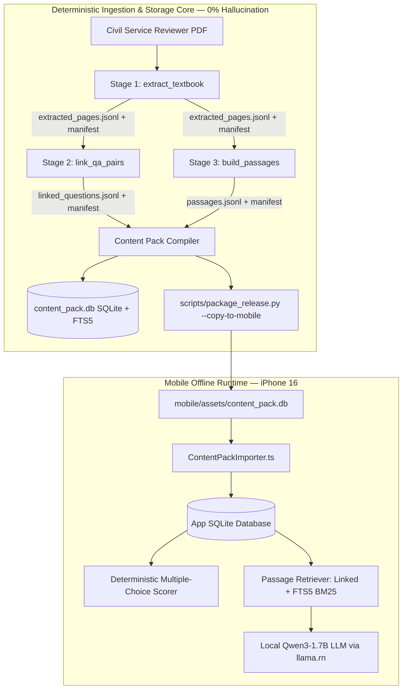
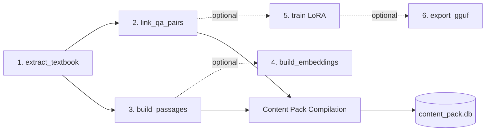
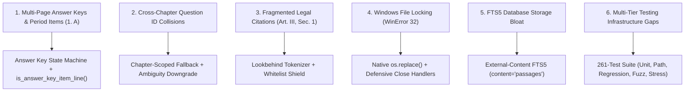
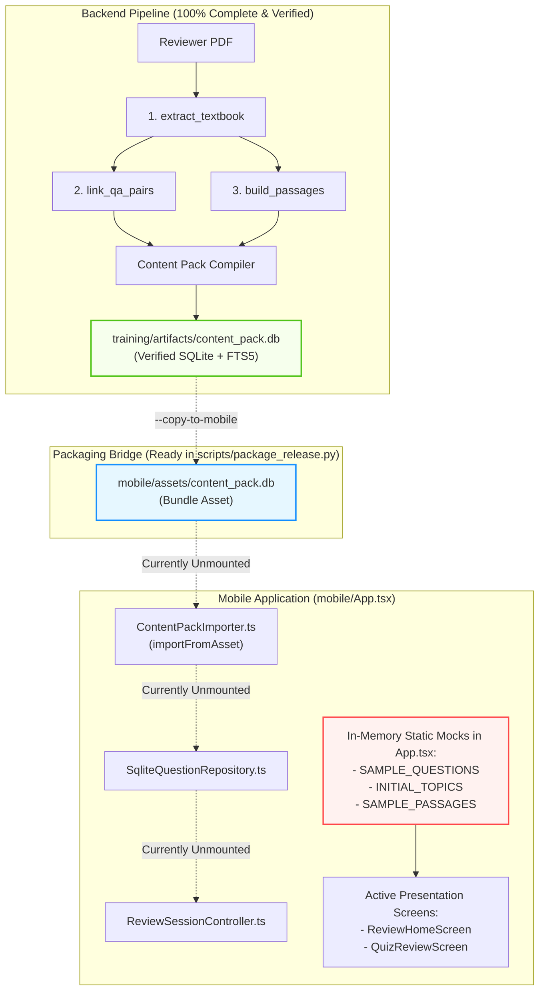
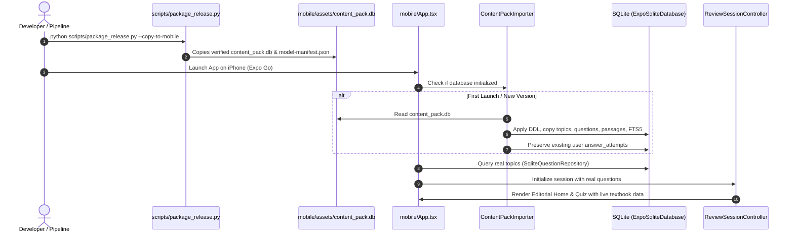

# Comprehensive Training Pipeline Logic & Architecture Documentation: `ai-tutor-training`

**Target Directory:** [`D:\MobileApp Rag\training`](file:///d:/MobileApp%20Rag/training)  
**Package Name:** `ai-tutor-training`  
**Package Version:** `0.3.0`  
**Runtime & Frameworks:** Python 3.11+ (Python 3.13.7 active), PyMuPDF 1.25.0+, SQLite 3 with FTS5, Click 8.1+, PyYAML 6.0+, jsonschema 4.23+, Hypothesis 6.100+  
**Target Hardware:** Windows Local Workstation (Development & Ingestion) $\rightarrow$ iPhone 16 (Apple Silicon Metal GPU / iOS Native Offline Deployment)  
**Output Target:** Standalone SQLite Content Pack (`content_pack.db`) with FTS5 BM25 search index and cryptographic provenance manifests

---

## 1. Executive Summary & Architectural Overview

The **AI Tutor Training & Data Preparation Pipeline** (`ai-tutor-training`) is an offline, deterministic data engineering and content compilation system. Its core responsibility is ingesting unstructured, multi-page Philippine Civil Service Examination PDF reviewer materials and transforming them into an auditable, relational SQLite database (`content_pack.db`) equipped with an external-content **FTS5 BM25** search index for instant, sub-millisecond retrieval on mobile devices.

### 1.1 The Core Architectural Invariant: Deterministic vs. Probabilistic



The system strictly enforces the following architectural principles:
1. **The LLM Never Scores Exams or Determines Answer Keys**: Every question stem, choice, canonical answer, and explanation is extracted deterministically using multi-pass state machines, verified against official answer keys, and stored in relational SQLite tables. Multiple-choice scoring is a simple, zero-AI relational comparison taking `< 1 ms`.
2. **Strict Physical Auditability**: Every extracted question and passage preserves exact 1:1 page correspondence matching the physical source textbook. Student citations (e.g. `[Page 42]`) are 100% physically verifiable.
3. **Storage Zero-Duplication**: Full-text search over passages uses an external-content SQLite FTS5 table (`content='passages', content_rowid='rowid'`), enabling fast BM25 search without duplicating passage text, keeping the offline mobile bundle minimal.
4. **Offline Reproducibility**: All stages generate cryptographic SHA-256 manifests (`extract_manifest.json`, `link_manifest.json`, `passages_manifest.json`, `content_pack_manifest.json`) recording environment metadata, package versions, execution timings, and input/output hashes.

---

## 2. Stage-by-Stage Workflow & Detailed Responsible Functions

The training pipeline consists of 6 declared stages, content pack compilation, CLI orchestration, and evaluation layers:



---

### 2.1 Stage 1: Page-by-Page Textbook Extraction ([`extract_textbook.py`](file:///d:/MobileApp%20Rag/training/src/ai_tutor_training/stages/extract_textbook.py))

**Module:** `ai_tutor_training.stages.extract_textbook`  
**Input:** Source PDF file (`data/raw/reviewer.pdf`)  
**Output:** `artifacts/extracted_pages.jsonl` + `artifacts/extract_manifest.json`  
**Contract:** [`contracts/extracted-page.schema.json`](file:///d:/MobileApp%20Rag/contracts/extracted-page.schema.json)

#### Responsible Functions:

1. **`extract_textbook(pdf_path, config=None, output_path=None, manifest_path=None) -> list[dict[str, Any]]`**
   - **Responsibility**: Top-level stage driver. Opens the PDF via PyMuPDF (`fitz`), iterates page-by-page, tracks chapter/section hierarchy across page transitions, writes atomic output JSONL, and records the stage manifest.
   - **Invariants**:
     - 1-based page numbering: `page_number = page_idx + 1`.
     - Zero unhandled blank pages: if stripped page text is empty, records `is_empty = True` and `empty_reason = "No text content detected"`.
     - Context carryover: `active_chapter` and `active_section` persist from previous pages unless explicitly redefined by a new detected header.
     - Atomic replacement: writes to temporary file `.tmp.<uuid>.jsonl` and invokes `os.replace` to eliminate Windows file-locking race conditions.

2. **`extract_page_headings(text, chapter_patterns, section_patterns) -> tuple[str | None, str | None, list[str]]`**
   - **Responsibility**: Scans non-empty text lines of a page against regular expressions to detect chapter and section titles.
   - **Heading Regex Patterns**:
     - *Chapter Patterns*:
       ```python
       r"^(?:CHAPTER|Chapter|KABANATA|Kabanata)\s+[\dIVXLCDM]+[.:]?\s*(.*)"
       r"^(?:PART|Part|BAHAGI|Bahagi)\s+[\dIVXLCDM]+[.:]?\s*(.*)"
       r"^(?:ENGLISH|MATH|FILIPINO|GENERAL\s+(?:INFORMATION|LAWS?)|CLERICAL\s+OPERATIONS)"
       r"^(?:NUMERICAL\s+ABILITY|VERBAL\s+ABILITY|ANALYTICAL\s+ABILITY)"
       ```
     - *Section Patterns*:
       ```python
       r"^(?:Section|Seksyon)(?:\s+[\dIVXLCDM]+)?[.:]?\s*(.*)"
       r"^(?:Vocabulary|Grammar|Reading Comprehension|Analogy|Logic|Word Problems)"
       r"^(?:Balarila|Talasalitaan|Pagbasa|Saligang Batas|R\.A\.\s*6713)"
       ```
     - *Capture Semantics*: Captures regex group 1 (e.g. `"General Information"`) if present, otherwise uses the trimmed line text. Supports both numbered (`Section 1: ...`) and unnumbered (`Section: Philippine Constitution`) headings.

---

### 2.2 Stage 2: Question-Answer Linkage & Classification ([`link_qa_pairs.py`](file:///d:/MobileApp%20Rag/training/src/ai_tutor_training/stages/link_qa_pairs.py))

**Module:** `ai_tutor_training.stages.link_qa_pairs`  
**Input:** `artifacts/extracted_pages.jsonl`  
**Output:** `artifacts/linked_questions.jsonl` + `artifacts/link_manifest.json`  
**Contract:** [`contracts/linked-question.schema.json`](file:///d:/MobileApp%20Rag/contracts/linked-question.schema.json)

#### Responsible Functions:

1. **`link_qa_pairs(extracted_pages_path, config=None, output_path=None, manifest_path=None) -> list[dict[str, Any]]`**
   - **Responsibility**: Coordinates Pass 1 and Pass 2, reconciles candidate answers with questions, executes cross-chapter fallback logic, assigns IDs (`q0001`, `q0002`), performs atomic publishing, and writes provenance manifests.

2. **`parse_answer_keys(pages, header_patterns, item_patterns, c_patterns, q_patterns) -> tuple[dict, list]`**
   - **Responsibility**: **Pass 1 of the Ingestion Algorithm**. Scans all extracted pages to collect answer keys before question parsing begins.
   - **State Machine Rules**:
     - *Activation*: Triggered when a line matches `answer_key_header_patterns`:
       ```python
       r"(?i)(?:answer\s+key|susi\s+sa\s+pagwawasto|mga\s+tamang\s+sagot|correct\s+answers)"
       ```
     - *Page Continuity*: Answer key state persists across physical page boundaries. If an answer key begins at the bottom of Page 10 and continues onto Page 11, `in_answer_key` remains `True`.
     - *Explicit Deactivation*: Answer key state is terminated immediately when encountering:
       1. A chapter or part heading (`CHAPTER 2`, `Part II`).
       2. A question stem that is **not** an answer key item line (e.g., `1. What is administrative ethics?`).
     - *Item Extraction*: Parses items matching `item_patterns` (e.g., `1 - C`, `1. A`, `1 B`) into `chapter_keys[(chapter, q_num)] = (ans_char, page_num)` and `global_keys.append((q_num, ans_char, page_num))`.
     - *Text Answers*: Supports identification/short-answer keys (e.g., `4 - Republic Act 6713`).

3. **`is_answer_key_item_line(line, item_patterns) -> bool`**
   - **Responsibility**: Disambiguates period-formatted answer keys (e.g. `1. A`) from real question stems (e.g. `1. Which of the following is correct?`).
   - **Rule**: If a line begins with `1. A`, has no lowercase letters, and contains under 30 characters, it is classified as an answer key entry, preventing question regexes from absorbing it.

4. **`parse_questions_from_pages(pages, q_patterns, c_patterns, ak_header_patterns, ak_item_patterns) -> list[dict]`**
   - **Responsibility**: **Pass 2 of the Ingestion Algorithm**. State machine extracting question stems, multiple-choice options A–D, and inline rationale notes.
   - **State Flow**:
     - Closes existing question accumulator when a new question stem is matched (`q_patterns`):
       ```python
       r"^\s*(\d{1,4})[.)]\s+(.*)"
       r"^\s*Question\s+(\d{1,4})[.:]\s*(.*)"
       r"^\s*Tanong\s+(\d{1,4})[.:]\s*(.*)"
       ```
     - Matches multiple-choice choices (`c_patterns`):
       ```python
       r"^\s*([A-Da-d])[.)]\s+(.*)"
       r"^\s*\[([A-Da-d])\]\s*(.*)"
       ```
     - Extracts inline answers (`Answer: A`, `Sagot: C`) and rationale notes (`Note: ...`, `Explanation: ...`).
     - Ignores answer key sections encountered in Pass 2 to avoid duplicate parsing.

5. **`classify_question_type(stem, choices) -> str`**
   - **Responsibility**: Heuristic classifier returning `"multiple_choice"`, `"essay"`, or `"identification"`.
   - **Logic**:
     - If `choices` exists and `len(choices) > 0` $\rightarrow$ `"multiple_choice"`.
     - If stem contains essay keywords (`"explain"`, `"ipaliwanag"`, `"discuss"`, `"talakayin"`, `"in your own words"`, `"enumerate"`, `"isa-isahin"`) $\rightarrow$ `"essay"`.
     - Otherwise $\rightarrow$ `"identification"`.

6. **Cross-Chapter Answer Key Fallback Logic**:
   - *Primary*: Matches `chapter_keys.get((chapter, raw_num))`.
   - *Secondary*: Matches normalized chapter substring (e.g. `"Chapter 1"` in `"Chapter 1: General Info"`).
   - *Global Fallback*: If not found and question has **no inline answer**, scans all candidate keys across chapters matching `q_cand == raw_num`:
     - If exactly 1 candidate exists globally $\rightarrow$ binds key (`canonical_choice_key = ans_cand`).
     - If $> 1$ candidates exist across disparate chapters $\rightarrow$ marks ambiguity, sets `canonical_choice_key = None`, and downgrades confidence to `"unresolved"` with warning in `link_warnings`.
   - *Inline Answer Priority*: If a question has an inline answer (`Answer: A`), it is never overwritten by a disparate chapter's answer key.

---

### 2.3 Stage 3: Sentence-Bounded Passage Chunking ([`build_passages.py`](file:///d:/MobileApp%20Rag/training/src/ai_tutor_training/stages/build_passages.py))

**Module:** `ai_tutor_training.stages.build_passages`  
**Input:** `artifacts/extracted_pages.jsonl`  
**Output:** `artifacts/passages.jsonl` + `artifacts/passages_manifest.json`  
**Contract:** [`contracts/passage.schema.json`](file:///d:/MobileApp%20Rag/contracts/passage.schema.json)

#### Responsible Functions:

1. **`build_passages(extracted_pages_path, config=None, output_path=None, manifest_path=None) -> list[dict[str, Any]]`**
   - **Responsibility**: Loads non-empty extracted pages, chunks text into bounded passages, assigns stable IDs (`p0001`, `p0002`), performs atomic file replacement, and writes stage manifest.

2. **`split_into_sentences(text) -> list[str]`**
   - **Responsibility**: Sentence tokenizer with lookbehind boundary detection and a comprehensive abbreviation shield.
   - **Philippine Legal Abbreviation Whitelist**:
     ```python
     ABBREVIATIONS = [
         "no.", "art.", "sec.", "mr.", "ms.", "mrs.", "dr.", "prof.", "atty.",
         "vs.", "v.", "p.", "pp.", "ra.", "r.a.", "p.d.", "b.p.", "blg.", "pah.",
         "vol.", "par.", "para.", "ch.", "dept.", "gov.", "gen.", "col.", "lt.",
         "pres.", "sen.", "rep.", "univ.", "sr.", "jr.", "cf.", "al."
     ]
     ```
   - **Protection Mechanism**: Temporarily masks periods following whitelisted abbreviations (e.g. `Art.` $\rightarrow$ `Art\uE000`), applies sentence boundary split on standard punctuation (`.`, `!`, `?`), cleans whitespace, and unmasks periods. Prevents citations like `Art. III, Sec. 1` from being split across passages.

3. **`count_words(text) -> int`**
   - **Responsibility**: Counts whitespace-delimited tokens for passage window budgeting.

4. **`chunk_page_text(pages, max_words=300, overlap_words=50) -> list[dict[str, Any]]`**
   - **Responsibility**: Bounded sliding-window chunker.
   - **Invariants**:
     - Never breaks sentences across chunk boundaries.
     - Never merges text across different chapters.
     - Enforces `max_words = 300` per passage.
     - Maintains `overlap_words = 50` between consecutive passages for retrieval context continuity.
     - Computes SHA-256 `content_hash` over passage text.

---

### 2.4 Content Pack Compilation ([`content_pack.py`](file:///d:/MobileApp%20Rag/training/src/ai_tutor_training/content_pack.py))

**Module:** `ai_tutor_training.content_pack`  
**Input:** `artifacts/linked_questions.jsonl` and `artifacts/passages.jsonl`  
**Output:** `artifacts/content_pack.db` (SQLite) + `artifacts/content_pack_manifest.json`  
**Target Consumer:** `mobile/assets/content_pack.db`

#### Responsible Function:

**`build_content_pack(linked_questions_path, passages_path, output_db_path, version="2026.10.1", config=None, manifest_path=None) -> Path`**
- **Responsibility**: Compiles the final offline SQLite database enforcing foreign key relationships and FTS5 indexing.

#### Relational Schema Architecture:
```sql
PRAGMA foreign_keys = ON;

-- Topics table
CREATE TABLE topics (
    id TEXT PRIMARY KEY,
    title TEXT NOT NULL,
    sort_order INTEGER NOT NULL DEFAULT 0
);

-- Passages table
CREATE TABLE passages (
    id TEXT PRIMARY KEY,
    chapter TEXT,
    section TEXT,
    start_page INTEGER NOT NULL,
    end_page INTEGER NOT NULL,
    text TEXT NOT NULL,
    content_hash TEXT NOT NULL
);

-- External-Content FTS5 Virtual Table (Zero text duplication)
CREATE VIRTUAL TABLE passages_fts USING fts5(
    passage_id UNINDEXED,
    chapter,
    section,
    text,
    content='passages',
    content_rowid='rowid'
);

-- Questions table
CREATE TABLE questions (
    id TEXT PRIMARY KEY,
    topic_id TEXT NOT NULL REFERENCES topics(id) ON DELETE CASCADE,
    question_type TEXT NOT NULL CHECK(question_type IN ('multiple_choice', 'identification', 'essay')),
    stem TEXT NOT NULL,
    canonical_explanation TEXT,
    source_page INTEGER NOT NULL,
    difficulty TEXT CHECK(difficulty IN ('easy', 'medium', 'hard') OR difficulty IS NULL),
    link_confidence TEXT NOT NULL CHECK(link_confidence IN ('verified', 'high', 'low', 'unresolved')),
    link_warnings TEXT
);

-- Choices table (for multiple-choice)
CREATE TABLE choices (
    id TEXT PRIMARY KEY,
    question_id TEXT NOT NULL REFERENCES questions(id) ON DELETE CASCADE,
    choice_key TEXT NOT NULL,
    text TEXT NOT NULL,
    sort_order INTEGER NOT NULL DEFAULT 0
);

-- Canonical Answers table
CREATE TABLE question_answers (
    question_id TEXT PRIMARY KEY REFERENCES questions(id) ON DELETE CASCADE,
    canonical_choice_id TEXT REFERENCES choices(id) ON DELETE SET NULL,
    canonical_answer_text TEXT NOT NULL
);

-- Question-Passage Links (Tier 1 Evidence)
CREATE TABLE question_passages (
    question_id TEXT NOT NULL REFERENCES questions(id) ON DELETE CASCADE,
    passage_id TEXT NOT NULL REFERENCES passages(id) ON DELETE CASCADE,
    relevance_score REAL NOT NULL DEFAULT 1.0,
    PRIMARY KEY (question_id, passage_id)
);

-- Content Pack Metadata
CREATE TABLE content_pack_metadata (
    pack_id TEXT PRIMARY KEY,
    version TEXT NOT NULL,
    source_revision TEXT NOT NULL,
    imported_at TEXT NOT NULL,
    content_hash TEXT NOT NULL
);

-- Mutable Learner State (Preserved across content pack updates)
CREATE TABLE study_sessions (
    id TEXT PRIMARY KEY,
    topic_id TEXT REFERENCES topics(id) ON DELETE SET NULL,
    started_at TEXT NOT NULL,
    completed_at TEXT,
    mode TEXT NOT NULL CHECK(mode IN ('all', 'unanswered', 'weak_areas')),
    total_questions INTEGER NOT NULL,
    correct_count INTEGER NOT NULL DEFAULT 0
);

CREATE TABLE answer_attempts (
    id TEXT PRIMARY KEY,
    session_id TEXT REFERENCES study_sessions(id) ON DELETE CASCADE,
    question_id TEXT NOT NULL REFERENCES questions(id) ON DELETE CASCADE,
    selected_choice_id TEXT REFERENCES choices(id) ON DELETE SET NULL,
    free_answer_text TEXT,
    is_correct INTEGER NOT NULL CHECK(is_correct IN (0, 1)),
    score REAL NOT NULL CHECK(score >= 0.0 AND score <= 1.0),
    attempted_at TEXT NOT NULL,
    latency_ms INTEGER
);
```

#### Compilation & Verification Invariants:
1. **FTS5 Ingestion**: Populates `passages_fts` directly from `passages` using `SELECT rowid, id, chapter, section, text FROM passages;`.
2. **Deterministic Linking**: For each question, links passages originating from the same `source_page` into `question_passages` (Tier 1 evidence).
3. **Database Constraints Verification**:
   - Executes `PRAGMA foreign_key_check;` $\rightarrow$ raises `RuntimeError` if any FK is violated.
   - Executes `PRAGMA integrity_check;` $\rightarrow$ raises `RuntimeError` if SQLite B-tree or page integrity fails.
4. **Composite Semantic Content Hash**: Computes SHA-256 over all question IDs, stems, canonical answers, and passage content hashes to produce an immutable `content_hash` stored in `content_pack_metadata`.
5. **Atomic Write**: Database is compiled into `artifacts/content_pack.db.tmp.<uuid>` and published via `os.replace`.

---

### 2.5 Pipeline CLI Orchestration ([`cli.py`](file:///d:/MobileApp%20Rag/training/src/ai_tutor_training/cli.py))

**Module:** `ai_tutor_training.cli`  
**Entry Point:** `ai-tutor-pipeline` (configured in `pyproject.toml`)

#### CLI Commands:

| Command | Signature | Description |
| :--- | :--- | :--- |
| **`extract`** | `ai-tutor-pipeline extract [--config] [--pdf] [--output] [--manifest]` | Runs Stage 1 PDF textbook extraction. |
| **`link`** | `ai-tutor-pipeline link [--config] [--input] [--output] [--manifest]` | Runs Stage 2 QA stem, choice, and answer key linkage. |
| **`build-passages`** | `ai-tutor-pipeline build-passages [--config] [--input] [--output] [--manifest]` | Runs Stage 3 sentence-bounded passage chunking. |
| **`build-content-pack`** | `ai-tutor-pipeline build-content-pack [--config] [--questions] [--passages] [--output] [--version] [--manifest]` | Compiles SQLite `content_pack.db` with FTS5 search. |
| **`validate`** | `ai-tutor-pipeline validate --artifact <path> --schema <path>` | Validates any JSONL artifact against a JSON Schema. |
| **`run-all`** | `ai-tutor-pipeline run-all [--config]` | Executes Stages 1 $\rightarrow$ 2 $\rightarrow$ 3 $\rightarrow$ Content Pack in a single pipeline execution. |

---

### 2.6 Provenance & Reproducibility ([`provenance/__init__.py`](file:///d:/MobileApp%20Rag/training/src/ai_tutor_training/provenance/__init__.py))

**Module:** `ai_tutor_training.provenance`  
**Contract:** [`contracts/stage-manifest.schema.json`](file:///d:/MobileApp%20Rag/contracts/stage-manifest.schema.json)

#### Responsible Functions:
- **`compute_sha256(path)`**: Computes chunked SHA-256 digest of any file.
- **`compute_dict_hash(data)`**: Computes deterministic SHA-256 over key-sorted JSON dictionaries.
- **`create_stage_manifest(...)`**: Creates stage manifest recording:
  - `stage`: Name of the stage (e.g. `"extract_textbook"`).
  - `started_at` & `ended_at`: ISO 8601 UTC timestamps.
  - `status`: `"success"` or `"failed"`.
  - `environment`: OS platform, Python version, Git commit revision, GPU model, and installed library versions (`pymupdf`, `jsonschema`, `pyyaml`, `click`, `pytest`, `torch`).
  - `parameters`: Config dict used for the stage.
  - `input_hashes`: SHA-256 hashes of all input files.
  - `output_hashes`: SHA-256 hashes of all output files.
- **`save_stage_manifest(...)`**: Atomically saves manifest JSON via `os.replace`.

---

### 2.7 AI Prompting & Evaluation Layer ([`prompting/`](file:///d:/MobileApp%20Rag/training/src/ai_tutor_training/prompting/__init__.py), [`evaluation/`](file:///d:/MobileApp%20Rag/training/src/ai_tutor_training/evaluation/__init__.py))

Governs the on-device inference contracts for **Feature A (`ExplainMore`)** and **Feature B (`InterpretFreeAnswer`)**:

1. **Feature A: Grounded `ExplainMore` Prompting**:
   - `build_explain_prompt(stem, canonical_answer, canonical_explanation, source_page, passage_text, max_passage_words=250)`:
     - Constrains prompt length well within the 1,024-token budget.
     - Treats passage text strictly as **DATA**, enclosed within `<context>[EXCERPT (Page X)]...</context>`, preventing prompt injection.
     - `sanitize_data_content(text)`: Strips XML delimiter tags (`<system>`, `<context>`, `<task>`) from user-supplied or excerpt text.
2. **Feature B: Semantic `InterpretFreeAnswer` Evaluation**:
   - `build_free_answer_prompt(stem, canonical_answer, user_answer, passages)`:
     - Prompts local Qwen3-1.7B to output a strictly formatted JSON object matching [`contracts/free-answer-verdict.schema.json`](file:///d:/MobileApp%20Rag/contracts/free-answer-verdict.schema.json).
   - `validate_and_score_free_answer(raw_llm_output, supplied_passage_ids, schema_path, confidence_threshold=0.75)`:
     - **Guardrail 1**: JSON syntax extraction and schema validation. If invalid $\rightarrow$ returns `uncertain`.
     - **Guardrail 2**: Evidence validation. If `evidence_passage_ids` contains IDs not in the prompt $\rightarrow$ returns `uncertain` (hallucination guard).
     - **Guardrail 3**: Confidence threshold. If `confidence < 0.75` $\rightarrow$ returns `uncertain`.
     - **Guardrail 4**: Deterministic grading:
       - `equivalent` $\rightarrow$ Score `1.0`.
       - `partially_equivalent` $\rightarrow$ Score `0.5`.
       - `incorrect` $\rightarrow$ Score `0.0`.
       - `ambiguous` $\rightarrow$ Prompt learner to self-grade (`uncertain`).

---

### 2.8 Post-MVP Optional Stages ([`stages/build_embeddings.py`](file:///d:/MobileApp%20Rag/training/src/ai_tutor_training/stages/build_embeddings.py), [`stages/train.py`](file:///d:/MobileApp%20Rag/training/src/ai_tutor_training/stages/train.py), [`stages/export_gguf.py`](file:///d:/MobileApp%20Rag/training/src/ai_tutor_training/stages/export_gguf.py))

1. **Stage 4 (`build_embeddings.py`)**: Optional passage embedding precomputation. Disabled for MVP because offline vector search on iOS requires bundling a secondary query embedding model in RAM; FTS5 BM25 lexical search provides sub-millisecond retrieval with 0 MB extra model overhead.
2. **Stage 5 (`train.py`)**: Optional LoRA/QLoRA fine-tuning. Disabled for baseline because pre-trained Qwen3-1.7B-GGUF Q4_K_M meets grounding accuracy thresholds when guided by retrieved textbook context.
3. **Stage 6 (`export_gguf.py`)**: GGUF export and quantization. Only activated if Stage 5 produces custom PyTorch adapters.

---

## 3. Specific Engineering Problems Encountered & Concrete Solutions

During the development and testing of the training pipeline, six major engineering defects and edge cases were identified, hardened, and verified:



### 3.1 Problem 1: Multi-Page Answer Key Continuation & Period-Formatted Items
- **Failure Mode**: In textbook reviewers, answer keys often span multiple physical pages without repeating the `"Answer Key"` header. Furthermore, period-formatted answer items (`1. A`) were mistakenly identified by question regexes (`1. <Stem>`) as new question stems, causing answer items to be parsed as incomplete questions and dropping corresponding answers.
- **Root Cause**: Pass 1 state was reset at page boundaries, and question detection in Pass 2 did not prioritize answer key item lines.
- **Hardening Fix**:
  1. In `link_qa_pairs.py`, `in_answer_key` persists across pages until explicitly closed by a new chapter heading or a real question stem.
  2. Implemented `is_answer_key_item_line(line, item_patterns)`: lines matching `^\d+[.)]\s*[A-D]$` without lowercase text are classified as answer items and shielded from question extraction.
  3. Ensured headings like `CHAPTER 2: Administrative Ethics` close answer key state before item absorption so they are not parsed as `2: A`.

### 3.2 Problem 2: Cross-Chapter False Matches When Question Numbering Resets
- **Failure Mode**: Most civil service review books reset question numbering at the start of each chapter (Chapter 1 has Items 1–20; Chapter 2 has Items 1–20). If Chapter 2 questions used inline answers (`Answer: A`) and had no end-of-chapter key, a naive global fallback matched Item 1 in Chapter 2 to Chapter 1's answer key (`1 - C`), overriding the correct inline answer.
- **Root Cause**: Global candidate matching in Pass 2 did not check if the candidate was from a conflicting, distinct chapter, and did not respect existing `inline_answer` fields.
- **Hardening Fix**:
  1. Global fallback across chapters is executed **only if `not inline_answer`**. If a question specifies its own answer inline, it is never overridden.
  2. If multiple candidates exist across different chapters, confidence is downgraded to `"unresolved"`, `canonical_choice_key` is set to `None`, and an explicit diagnostic warning is recorded in `link_warnings`.

### 3.3 Problem 3: Preserving Bilingual Legal Citations During Sentence Segmentation
- **Failure Mode**: Standard regex sentence tokenizers (`[.!?]`) split sentences on periods, breaking Philippine legal citations like `Art. III, Sec. 1`, `R.A. 6713, Sec. 4`, `P.D. 1177`, `B.P. Blg. 881`, or `Pah. 42` into fragmented, unreadable chunks.
- **Root Cause**: Failure to differentiate end-of-sentence periods from legal, academic, and honorific abbreviations.
- **Hardening Fix**:
  - Implemented `split_into_sentences` in `build_passages.py` with an extensive bilingual abbreviation whitelist. Periods following whitelisted tokens are masked with Unicode placeholder `\uE000` before splitting and restored afterward, preserving citation integrity 100%.

### 3.4 Problem 4: Eliminating Windows TOCTOU File-Lock Race Conditions
- **Failure Mode**: When updating pipeline outputs or SQLite databases on Windows, patterns using `if target.exists(): target.unlink()` followed by `shutil.move` triggered `WinError 32: The process cannot access the file because it is being used by another process`.
- **Root Cause**: Windows NTFS file handles are not immediately released upon closure, creating a Time-of-Check to Time-of-Use (TOCTOU) collision window.
- **Hardening Fix**:
  - Migrated `extract_textbook.py`, `link_qa_pairs.py`, `build_passages.py`, `content_pack.py`, and `provenance/__init__.py` to Python's atomic `os.replace(temp_file, target_file)`.
  - Wrapped SQLite connection objects and PyMuPDF document handles in `try...finally` blocks, explicitly calling `.close()` before file operations.

### 3.5 Problem 5: Sub-Millisecond Offline Search Without Storage Duplication
- **Failure Mode**: Standard SQLite FTS5 tables duplicate the indexed text columns, nearly doubling the database footprint on user mobile devices.
- **Root Cause**: Default FTS5 tables store their own internal copy of all indexed text content.
- **Hardening Fix**:
  - Configured `passages_fts` as an **external-content table**:
    ```sql
    CREATE VIRTUAL TABLE passages_fts USING fts5(
        passage_id UNINDEXED,
        chapter,
        section,
        text,
        content='passages',
        content_rowid='rowid'
    );
    ```
  - FTS5 indexes the tokens via `rowid` pointing directly to the `passages` table without duplicating text, keeping `content_pack.db` lightweight and fast.

### 3.6 Problem 6: Multi-Tier Testing Infrastructure (261 Tests Total)
- **Failure Mode**: Pipeline tests were previously limited to basic happy-path checks, leaving edge cases in regexes, Roman numerals, control flow paths, and stress benchmarks untested.
- **Hardening Fix**:
  - Built an exhaustive **261-test suite** across 17 test modules:
    - **64 Isolated Unit Tests** ([`test_unit_isolated.py`](file:///d:/MobileApp%20Rag/training/tests/test_unit_isolated.py)): regexes, abbreviations, hashes, classifiers.
    - **36 Basis Path Tests** ([`test_basis_paths.py`](file:///d:/MobileApp%20Rag/training/tests/test_basis_paths.py)): McCabe cyclomatic complexity coverage across every branch.
    - **13 Advanced Regression Tests** ([`test_regression_advanced.py`](file:///d:/MobileApp%20Rag/training/tests/test_regression_advanced.py)): multi-page continuation, period keys, closing headers.
    - **8 Property-Based Fuzz Tests** ([`test_property_fuzz.py`](file:///d:/MobileApp%20Rag/training/tests/test_property_fuzz.py)): Hypothesis fuzzing for tokenizer invariants and prompt injection sanitization.
    - **3 Stress Benchmarks** ([`test_stress_benchmarks.py`](file:///d:/MobileApp%20Rag/training/tests/test_stress_benchmarks.py)): 1,000-question SQLite throughput, sub-millisecond FTS5 BM25 search latency (<2ms), 100-page PyMuPDF extraction scale.
    - Segregated tests with `@pytest.mark.stress` so standard runs finish in **26s** while full runs verify scalability.

---

## 4. The Critical Problem Facing the Project: The Pipeline-to-Mobile Integration Gap

While both the backend training pipeline (`ai-tutor-training`) and the mobile architecture (`ai-tutor-mobile`) are fully tested and operational individually, an architectural disconnect currently exists between them:



### 4.1 Diagnosis of the Current Disconnect
1. **The In-Memory Mock Trap**: [`mobile/App.tsx`](file:///d:/MobileApp%20Rag/mobile/App.tsx) currently drives the UI using local React `useState` initialized with static in-memory mocks (`SAMPLE_QUESTIONS`, `INITIAL_TOPICS`, `SAMPLE_PASSAGES`).
2. **Unmounted Production Core**: The production SQLite repositories ([`sqlite_question_repository.ts`](file:///d:/MobileApp%20Rag/mobile/src/data/sqlite/sqlite_question_repository.ts)), database adapter ([`expo_sqlite_database.ts`](file:///d:/MobileApp%20Rag/mobile/src/data/sqlite/expo_sqlite_database.ts)), and headless controller ([`review_session_controller.ts`](file:///d:/MobileApp%20Rag/mobile/src/controllers/review_session_controller.ts)) are implemented and pass all 74 unit tests, but are **not yet mounted** in `App.tsx`.
3. **Missing Content Pack Asset in Mobile**: `training/artifacts/content_pack.db` has not yet been copied into `mobile/assets/content_pack.db`.

### 4.2 Concrete 3-Step Resolution Blueprint

To bridge the verified training pipeline data directly into the user's mobile app:



1. **Step 1: Release Packaging (`package_release.py --copy-to-mobile`)**:
   Run the automated packager to validate all contract gates and copy the generated `content_pack.db` into `mobile/assets/`:
   ```powershell
   python scripts/package_release.py --copy-to-mobile
   ```
2. **Step 2: Database Initialization on App Launch**:
   In `mobile/App.tsx`, introduce an initial hydration effect using `ExpoSqliteDatabase` and `ContentPackImporter`:
   - Checks `content_pack_metadata` in the local SQLite database.
   - If not populated or version changed, imports `mobile/assets/content_pack.db` into the app's document directory while preserving user study history in `answer_attempts`.
3. **Step 3: Mount Connected Containers**:
   Replace static state handlers in `mobile/App.tsx` with `ConnectedReviewHomeScreen` and `ConnectedQuizReviewScreen`, allowing the UI to read live topic mastery metrics, execute PRNG choice shuffling, query Tier 1 and FTS5 BM25 passages, and record student answer attempts directly in SQLite.

---

## 5. Verification & Testing Matrix

The integrity of the pipeline logic and data contracts is continuously enforced across 335 total tests:

| Test Suite | Environment | Command | Tests | Status |
| :--- | :--- | :--- | :---: | :---: |
| **Python Standard Tests** | Workstation Virtualenv | `pytest training/tests -v -m "not stress"` | **258 passed** | **PASS** |
| **Python Stress Benchmarks** | Workstation Virtualenv | `pytest training/tests -v -m "stress"` | **3 passed** | **PASS** |
| **Total Pipeline Tests** | Workstation Virtualenv | `pytest training/tests -v` | **261 passed** | **PASS** |
| **Mobile TypeScript Tests** | Node.js Test Runner | `npm test --prefix mobile` | **74 passed** | **PASS** |
| **Combined System Tests** | End-to-End | — | **335 passed** | **PASS** |

### Git Commit Provenance
- `d58667f feat(training): implement multi-tier test suite across unit, integration, regression, path, property, and stress testing with backend hardening`
- `777fea9 test(training): add comprehensive unit, integration, boundary, and E2E pipeline tests with atomic file hardening`
- `7e06b61 feat(mobile): implement editorial iOS learning UI/UX for Home, Quiz, and Flashcards`

