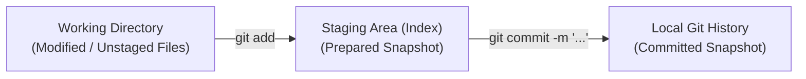

# Git Commit & Staging Documentation: Offline AI Tutor (RAG Reviewer)

This guide defines the Git contribution, staging, and commit workflow for the Offline AI Tutor project. It aligns daily development with our automated **Semantic Versioning 2.0.0** engine ([`scripts/bump_version.py`](file:///d:/MobileApp%20Rag/scripts/bump_version.py)) and Zero-Defect release packaging ([`scripts/package_release.py`](file:///d:/MobileApp%20Rag/scripts/package_release.py)).

---

## 1. The Fundamental Rule: Stage Only What You Intend to Commit

Git separates files into three distinct areas:



- **Working Directory**: All modified, untracked, or deleted files on disk.
- **Staging Area (`index`)**: Only the specific changes selected for the next commit snapshot.
- **Local Git History (`HEAD`)**: Auditable, immutable commit records with unique SHA-1 hashes.

> [!IMPORTANT]
> Running `git add` does not publish code or affect other branches. Running `git commit` records only the staged index, not uncommitted changes in your working directory. Never use `git add .` blindly when unrelated changes exist in other directories.

---

## 2. Conventional Commits 1.0.0 Specification

Every commit message must follow the [Conventional Commits 1.0.0](https://www.conventionalcommits.org/en/v1.0.0/) standard:

```text
<type>(<scope>): <description>

[optional body]

[optional footer(s)]
```

### Approved Scopes

| Scope | Target Component | Typical Directory |
|---|---|---|
| `backend` | Python pipeline core, SQLite repositories, CLI | `training/src/ai_tutor_training/` |
| `mobile` | React Native / Expo UI, native runtime, bridge | `mobile/src/`, `mobile/package.json` |
| `training` | Text extraction, QA linking, sentence chunking | `training/src/ai_tutor_training/stages/` |
| `content-pack` | SQLite schema, question bank, reviewer passages | `training/configs/pipeline.yaml`, `contracts/` |
| `versioning` | SemVer 2.0.0 bumper and release packager | `scripts/bump_version.py`, `scripts/package_release.py` |
| `tests` | Automated pytest and node test suites | `training/tests/`, `mobile/tests/` |
| `docs` | System architecture, ADRs, user guides | `docs/`, `*.md` |

### SemVer Impact Mapping

| Commit Type | SemVer Increment | Trigger Example |
|---|---|---|
| `feat:` / `feat(<scope>):` | **MINOR** | `feat(mobile): add FreeAnswer semantic evaluation screen` |
| `fix:` / `fix(<scope>):` | **PATCH** | `fix(training): correct sentence splitting lookbehind for quotes` |
| `perf:` / `refactor:` | **PATCH** | `perf(backend): optimize FTS5 virtual table joins` |
| `BREAKING CHANGE:` / `<type>!:` | **MAJOR** | `feat(backend)!: change database schema breaking existing content packs` |
| `docs:` / `test:` / `chore:` | *None (no bump)* | `docs(git): document scoped staging workflow` |

---

## 3. Scoped Staging Commands by Area

Execute these commands from repository root (`d:\MobileApp Rag` or `/d/MobileApp Rag` in Git Bash).

### A. Pre-Flight Inspection
Always inspect your working tree before staging:
```bash
git branch --show-current
git status --short
git diff --stat
```

### B. Mobile Application Changes
```bash
git add mobile/src/
git diff --cached
git commit -m "feat(mobile): implement offline SQLite question repository"
```
*Note: Stage `mobile/package.json` only when dependencies or metadata are directly part of the change.*

### C. Training Pipeline Changes
```bash
git add training/src/ai_tutor_training/stages/build_passages.py
git add training/tests/test_build_passages.py
git diff --cached
git commit -m "fix(training): handle legal citations in sentence splitter"
```

### D. Content Pack & Configuration Changes
```bash
git add training/configs/pipeline.yaml
git diff --cached
git commit -m "fix(content-pack): update question metadata for 2026 syllabus"
```

### E. Versioning & Release Automation
```bash
git add scripts/bump_version.py
git add training/tests/test_bump_version.py
git diff --cached
git commit -m "feat(versioning): automate semantic version bumps"
```

### F. Tests and Documentation
```bash
git add training/tests/
git commit -m "test(training): add test suite for evaluation guardrails"

git add docs/git-commit-workflow.md
git commit -m "docs(git): document scoped staging workflow"
```

---

## 4. How to Commit Only Part of a File (`git add -p`)

When a single file contains both a bug fix and a feature:
```bash
git add -p path/to/file.py
```
- `y`: Stage this hunk
- `n`: Skip this hunk
- `s`: Split the hunk into smaller pieces
- `q`: Quit interactive staging

Review staged vs unstaged diffs:
```bash
git diff --cached  # Review what will be committed
git diff           # Review what remains in working directory
```

---

## 5. Standard 7-Step Development Loop

Follow this sequence for every change:

1. **Confirm active branch**:
   ```bash
   git branch --show-current
   ```
2. **Inspect working tree**:
   ```bash
   git status --short
   ```
3. **Stage explicit files**:
   ```bash
   git add training/src/ai_tutor_training/evaluation/__init__.py
   git add training/tests/test_evaluation_and_prompting.py
   ```
4. **Verify the index**:
   ```bash
   git diff --cached
   git status --short
   ```
5. **Run targeted and regression tests**:
   ```bash
   pytest training/tests/test_evaluation_and_prompting.py
   pytest training/tests
   ```
6. **Commit with Conventional Commit syntax**:
   ```bash
   git commit -m "feat(backend): add schema validation guardrail for FreeAnswer"
   ```
7. **Verify commit record**:
   ```bash
   git show --stat --oneline HEAD
   git status --short
   ```

---

## 6. Integration with SemVer 2.0.0 Automation

Our automated release tooling ([`scripts/bump_version.py`](file:///d:/MobileApp%20Rag/scripts/bump_version.py)) reads the commit history since the latest release tag:

```powershell
# Analyze commit messages since last tag and increment appropriately
python scripts/bump_version.py app auto

# Explicit increment overrides
python scripts/bump_version.py app minor
python scripts/bump_version.py content-pack patch

# Safe preview before committing
python scripts/bump_version.py app minor --dry-run
```

- **App Code**: Bumping updates `pyproject.toml`, `training/pyproject.toml`, and `mobile/package.json`, then creates tag `vX.Y.Z`.
- **Content Pack**: Bumping updates `training/configs/pipeline.yaml`, then creates tag `content-vX.Y.Z`.
- **Changelog**: Release entries are automatically written to `CHANGELOG.md`.

---

## 7. Golden Repository Rules

1. **One logical change per commit**: Do not mix mobile UI components, pipeline regex fixes, and documentation edits into a single commit.
2. **Stage explicitly**: Prefer `git add <file>` over `git add .` to avoid accidentally committing untracked files or scratch files.
3. **Never commit secrets or proprietary data**: Verify that raw reviewer PDFs (`training/data/raw/`) and compiled artifacts (`training/artifacts/`) remain gitignored.
4. **Keep tests alongside implementation**: Commit feature code and its corresponding test in the same commit.
5. **Separate release bumps from code commits**: Version bumps belong to the release workflow (`bump_version.py`), not daily routine commits.
6. **Always verify tests before pushing**: Ensure all 52+ unit and contract tests pass before pushing to `main`.
