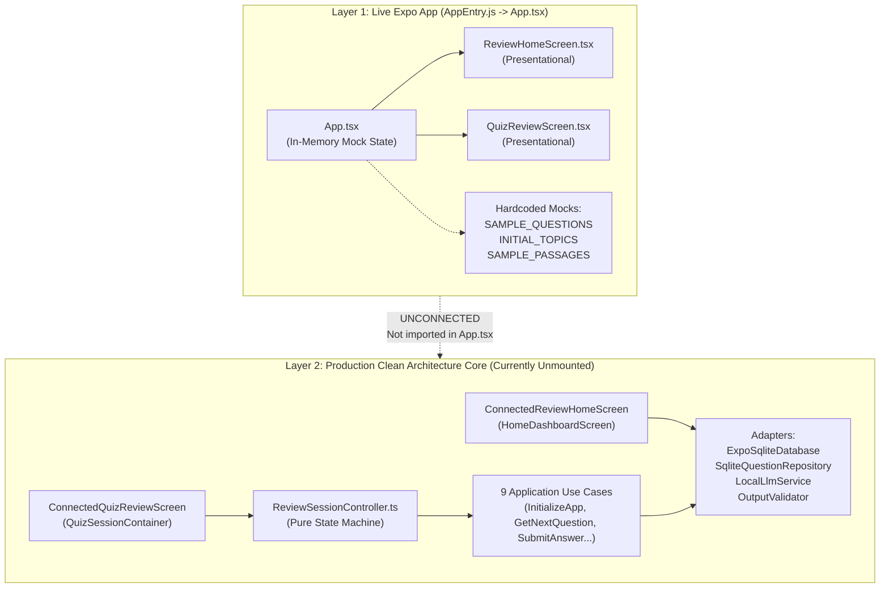
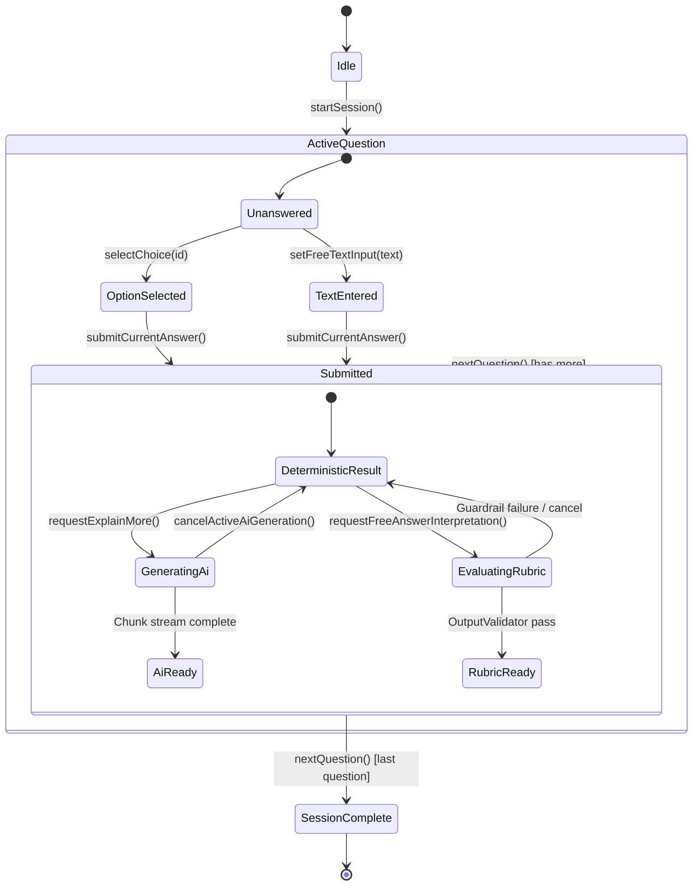

# Comprehensive Frontend Logic & Architecture Documentation: `ai-tutor-mobile`

**Target Directory:** [`D:\MobileApp Rag\mobile`](file:///d:/MobileApp%20Rag/mobile)  
**Package Name:** `ai-tutor-mobile`  
**Package Version:** `0.3.0`  
**Runtime & Frameworks:** React 19.2.3, React Native 0.86.3, Expo SDK 57 (`~57.0.30`), TypeScript 5.6.0 (`NodeNext` ESM)  
**Target Hardware:** iPhone 16 (Apple Silicon Metal GPU / iOS Native, fully offline post-provisioning)  
**Design Standard:** Philippine Civil Service Commission (CSC) Brand Guidelines & Apple Human Interface Guidelines (HIG)

---

## 1. Executive Summary & Architectural Reality

An exhaustive code audit of the frontend codebase in `D:\MobileApp Rag\mobile` reveals a dual-layer architecture:
1. **Layer 1: The Live Expo App Shell ([`App.tsx`](file:///d:/MobileApp%20Rag/mobile/App.tsx))**
   - The current active entry point executed by `expo/AppEntry.js`.
   - Runs directly on local React `useState` hooks with static in-memory mocks (`SAMPLE_QUESTIONS`, `INITIAL_TOPICS`, `SAMPLE_PASSAGES`).
   - Does **not** import or instantiate the production controller, SQLite repositories, or on-device LLM adapters.
2. **Layer 2: The Production Clean Architecture Core ([`mobile/src/`](file:///d:/MobileApp%20Rag/mobile/src))**
   - A fully tested (74/74 passing tests), modular, headless hexagonal architecture.
   - Encapsulated within connected UI containers ([`ConnectedReviewHomeScreen`](file:///d:/MobileApp%20Rag/mobile/src/features/review/ReviewHomeScreen.tsx#L295-L338), [`ConnectedQuizReviewScreen`](file:///d:/MobileApp%20Rag/mobile/src/features/quiz/QuizReviewScreen.tsx#L601-L648)), the headless state machine [`ReviewSessionController`](file:///d:/MobileApp%20Rag/mobile/src/controllers/review_session_controller.ts), 9 application use cases, SQLite repositories with FTS5 BM25 search, and an on-device LLM service with 4-tier output validation.



---

## 2. Route Reality Audit & Conceptual Feature Mapping

### Empirical Routing Truth
The codebase contains **no URL-based routing or Expo Router (`expo-router`)**.
- Git commit `2cb4f47` explicitly renamed `mobile/src/app` to `mobile/src/controllers` to prevent Expo Router directory collision.
- Navigation is strictly state-driven:
  - In `App.tsx`: `currentScreen: 'home' | 'quiz'` ([L215](file:///d:/MobileApp%20Rag/mobile/App.tsx#L215)).
  - In `ReviewSessionController`: `isSessionCompleted: boolean`, `currentIndex: number` ([L31-L39](file:///d:/MobileApp%20Rag/mobile/src/controllers/review_session_controller.ts#L31-L39)).

### Conceptual Mapping of Requested Paths

| Requested Concept | Codebase Location | Actual Runtime Status in `App.tsx` | True Architectural Capability |
| :--- | :--- | :--- | :--- |
| **`/goal`** | [`ReviewHomeScreen.tsx#L64-L126`](file:///d:/MobileApp%20Rag/mobile/src/features/review/ReviewHomeScreen.tsx)<br>[`sqlite_question_repository.ts#L125-L157`](file:///d:/MobileApp%20Rag/mobile/src/data/sqlite/sqlite_question_repository.ts) | Rendered with static mock `INITIAL_TOPICS`. | Computes subject mastery, answered counts, accuracy badges, and remaining review counts (`"X left"`). |
| **`/learn`** | [`QuizReviewScreen.tsx#L207-L264`](file:///d:/MobileApp%20Rag/mobile/src/features/quiz/QuizReviewScreen.tsx)<br>[`CorePrimitives.tsx#L618-L685`](file:///d:/MobileApp%20Rag/mobile/src/components/CorePrimitives.tsx) | Rendered when `sessionFormat === 'flashcards'`. | Flip-to-reveal flashcard component. *Note:* Both "Review Again" and "Know It" currently invoke `onNextQuestion` without persisting rating. |
| **`/plan`** | [`ReviewHomeScreen.tsx#L145-L178`](file:///d:/MobileApp%20Rag/mobile/src/features/review/ReviewHomeScreen.tsx)<br>[`get_next_question.ts#L33-L70`](file:///d:/MobileApp%20Rag/mobile/src/application/use_cases/get_next_question.ts) | Filter selection works in UI (`'all'`, `'unanswered'`, `'weak_areas'`). | Configures question filtering; `GetNextQuestion` runs Mulberry32 PRNG choice shuffling with positional option protection. |
| **`/grill-me`** | [`QuizReviewScreen.tsx#L267-L427`](file:///d:/MobileApp%20Rag/mobile/src/features/quiz/QuizReviewScreen.tsx)<br>[`scoring.ts#L1-L100`](file:///d:/MobileApp%20Rag/mobile/src/domain/scoring.ts) | Active in `App.tsx` via `scoreMultipleChoice` & `scoreExactIdentification`. | High-intensity quiz with 58pt touch targets, millisecond elapsed timers (`durationMs`), deterministic grading, and textbook evidence cards. |
| **`/boost`** | [`explain_more.ts`](file:///d:/MobileApp%20Rag/mobile/src/application/use_cases/explain_more.ts)<br>[`interpret_free_answer.ts`](file:///d:/MobileApp%20Rag/mobile/src/application/use_cases/interpret_free_answer.ts)<br>[`output_validator.ts`](file:///d:/MobileApp%20Rag/mobile/src/ai/evaluation/output_validator.ts) | Mocked via 600ms `setTimeout` in `App.tsx`. Rubric button is suppressed. | Token-budgeted (1,024 max) grounded AI explanations and 4-guardrail semantic free-text answer grading. |
| **`/teamwork-preview`** | [`ARCHITECTURE.md#L21-L28`](file:///d:/MobileApp%20Rag/ARCHITECTURE.md#L21-L28) | **Explicit Non-Goal.** | Offline, single-user mobile tutor with zero remote servers, cloud sync, or multi-user features. |

---

## 3. Detailed Presentation Layer Breakdown

### 3.1. Root Entry Point: `App.tsx` ([`App.tsx`](file:///d:/MobileApp%20Rag/mobile/App.tsx))
Acts as the top-level container coordinating navigation and user gestures.

#### State Variables:
- `currentScreen: 'home' | 'quiz'` (Default: `'home'`).
- `selectedMode: StudyMode` (`'all' | 'unanswered' | 'weak_areas'`).
- `sessionFormat: SessionFormat` (`'quiz' | 'flashcards'`).
- `questionIndex: number` (0-indexed current question pointer).
- `selectedChoiceId: string | null` (Current choice selection).
- `freeTextInput: string` (Student's identification answer).
- `submissionResult: SubmitAnswerResponse | null` (Grading verdict, score, canonical explanation).
- `isGeneratingAi: boolean` (Loading indicator for AI explanation).
- `aiExplanation: string | null` (Rendered elaboration text).
- `aiError: string | null` (Error banner text).
- `modelStatus: ModelRuntimeStatus` (Mocked status: `{ state: 'loaded', peakMemoryBytes: 850 * 1024 * 1024 }`).

#### Event Handlers:
- `handleStartSession(topicId, format)`: Sets `sessionFormat`, resets index to 0, switches `currentScreen` to `'quiz'`.
- `handleSubmitAnswer()`: Runs deterministic scoring via `scoreMultipleChoice` or `scoreExactIdentification`. Fakes `durationMs: 1500`.
- `handleRequestExplainMore(language)`: Fakes generation with a 600ms `setTimeout` returning hardcoded text.
- `handleNextQuestion()`: Advances `questionIndex` or marks session completed.
- `handleRestartSession()`: Resets index to 0, clears answers and submissions.
- `handleReturnHome()`: Returns to `'home'` screen.

#### Identified Gaps in `App.tsx`:
1. `onRequestInterpretFreeAnswer` is **omitted** from `<QuizReviewScreen>` props ([L354-L378](file:///d:/MobileApp%20Rag/mobile/App.tsx#L354-L378)), suppressing the semantic rubric evaluation button.
2. Direct use of mock arrays (`SAMPLE_QUESTIONS`, `INITIAL_TOPICS`) bypasses SQLite and `ReviewSessionController`.

---

### 3.2. Home Dashboard: `ReviewHomeScreen.tsx` ([`ReviewHomeScreen.tsx`](file:///d:/MobileApp%20Rag/mobile/src/features/review/ReviewHomeScreen.tsx))
Editorial, content-first launchpad designed for iPhone 16.

```
+-------------------------------------------------------------+
| PHILIPPINE CIVIL SERVICE EXAM            [Ready - 850MB]    |
| Today's Study                                               |
+-------------------------------------------------------------+
| [ All Questions ]   [ Unanswered Only ]   [ Weak Areas ]    |
+-------------------------------------------------------------+
| Practice Topics                                             |
|                                                             |
| +---------------------------------------------------------+ |
| | Philippine Constitution & General Info                  | |
| | [=============>          ] 89% (40/45)         [105 left]| |
| | [ Practice Quiz (58pt) ]          [ Flashcards (58pt) ] | |
| +---------------------------------------------------------+ |
|                                                             |
| +---------------------------------------------------------+ |
| | Verbal Ability (English & Filipino)                     | |
| | [====================>   ] 79% (95/120)         [80 left]| |
| | [ Practice Quiz (58pt) ]          [ Flashcards (58pt) ] | |
| +---------------------------------------------------------+ |
+-------------------------------------------------------------+
```

#### Key Logic & Sub-components:
1. **Dynamic Progress Calculations ([L74-L90](file:///d:/MobileApp%20Rag/mobile/src/features/review/ReviewHomeScreen.tsx#L74-L90)):**
   - $totalQuestions = \sum \text{totalQuestions}$
   - $totalAnswered = \sum \text{answeredCount}$
   - $totalCorrect = \sum \text{correctCount}$
   - $overallAccuracy = \text{Math.round}((totalCorrect / totalAnswered) \times 100)$
   - $remainingQuestions = \max(totalQuestions - totalAnswered, 0)$ (shown in an accent red badge `"X left"`).
2. **Subject Row Item (`SubjectRow` in [L342-L435](file:///d:/MobileApp%20Rag/mobile/src/features/review/ReviewHomeScreen.tsx#L342-L435)):**
   - Topic title in semi-bold primary text.
   - Progress bar tracking answered proportion: $(answered / total) \times 100$.
   - Accuracy badge: Success Green (`#027A48`) if $\ge 75\%$, Warning Amber (`#B54708`) if $< 75\%$.
   - Dual session format launch buttons: `"Practice Quiz"` (primary blue) and `"Flashcards"` (secondary outline). Both enforce `minHeight: 50`.
3. **Connected Container ([`ConnectedReviewHomeScreen`](file:///d:/MobileApp%20Rag/mobile/src/features/review/ReviewHomeScreen.tsx#L295-L338)):**
   - Injects `QuestionRepository` and `LocalLlmPort`.
   - Fetches live summaries via `repository.getTopicSummaries()`.
   - Queries real engine readiness via `llmPort.getStatus()`.
   - Supports pull-to-refresh via `loadData()`.

---

### 3.3. Quiz & Flashcard Session: `QuizReviewScreen.tsx` ([`QuizReviewScreen.tsx`](file:///d:/MobileApp%20Rag/mobile/src/features/quiz/QuizReviewScreen.tsx))
Supports two study formats: Active Recall Flashcards and Evaluated Quiz Review.

#### Mode A: Flashcard Mode ([L207-L264](file:///d:/MobileApp%20Rag/mobile/src/features/quiz/QuizReviewScreen.tsx#L207-L264))
- Renders `<Flashcard>` with flip state managed by `isFlashcardRevealed`.
- Front face shows question stem, topic overline, and source page badge (`p. X`).
- Bottom bar shows `"Reveal Answer"` (primary button).
- Once revealed, bottom bar shows dual rating buttons: `"Review Again"` (secondary) and `"Know It"` (primary).
- *Identified Defect:* Both buttons execute `onNextQuestion` identically.

#### Mode B: Practice Quiz Mode ([L267-L427](file:///d:/MobileApp%20Rag/mobile/src/features/quiz/QuizReviewScreen.tsx#L267-L427))
- Displays top progress bar: `current={questionNumber}`, `total={totalQuestions}`.
- Question stem rendered with generous line height (28pt) for mobile readability.
- **Answer Selection (Pre-Submission):**
  - Multiple Choice: Stack of `<AnimatedChoiceRow>` components (`minHeight: 58`). Choice selection toggles `selectedChoiceId`.
  - Free Text / Identification: Text input field with clear button.
  - Bottom action bar renders `"Submit Answer"` (disabled until choice selected or input entered).
- **Feedback & Grounded Context (Post-Submission):**
  - Choice rows locked (`disabled={true}`). The selected choice and canonical choice are highlighted with green/red status borders and badges.
  - `<AnswerFeedbackBanner>` indicates `CORRECT` (green), `PARTIALLY CORRECT` (amber), or `INCORRECT` (red).
  - Canonical explanation rendered in an editorial card.
  - Verified textbook evidence cards (`<EvidenceCard>`) displaying chapter, section, and page badges.
  - **On-Device AI Elaboration Card:**
    - Dual language trigger buttons: `"Explain in English"` and `"Ipaliwanag sa Filipino"`.
    - Shows streaming/generating indicator.
    - Allows cancellation via `onCancelGeneration`.
  - **AI Semantic Rubric Button ([L519-L531](file:///d:/MobileApp%20Rag/mobile/src/features/quiz/QuizReviewScreen.tsx#L519-L531)):**
    - Renders `"Evaluate Answer with AI Rubric"` if `onRequestInterpretFreeAnswer` is supplied.
    - When evaluated, displays match status (`matched`, `partially_matched`, `missing`), confidence score, and guardrail validation flags.

---

### 3.4. Design System & Primitives: `tokens.ts` & `CorePrimitives.tsx`

Located in [`tokens.ts`](file:///d:/MobileApp%20Rag/mobile/src/theme/tokens.ts) and [`CorePrimitives.tsx`](file:///d:/MobileApp%20Rag/mobile/src/components/CorePrimitives.tsx).

#### 80/15/5 Visual Weight Hierarchy:
- **80% Calming Neutrals:**
  - Canvas: `#FFFFFF`
  - Background: `#F7F8FC`
  - Elevated Surface: `#FFFFFF`
  - Muted Surface: `#F1F3F9`
  - Subtle Border: `#E4E7EF`
  - Text Primary: `#191D2E` (14.2:1 contrast ratio against white canvas, WCAG AAA compliant).
- **15% CSC Brand Blue (`#2A338F`):**
  - Primary buttons, active tabs, progress fill, topic headers (10.67:1 contrast ratio, WCAG AAA).
- **5% Focal Accent Red (`#EC1C2D`):**
  - Strictly limited to small badges (`"X left"`, difficulty indicators) and dot indicators.
  - **WCAG Invariant:** Red on white fails WCAG AA (3.9:1). Red badges strictly use dark primary text (`#191D2E`) on a light red surface tint (`#FEE4E2`) with an accent red dot indicator.

#### Apple HIG Touch & Motion Tokens:
- `minTouchTarget: 44` (Buttons enforce `minHeight: 50`, choice rows enforce `minHeight: 58`).
- Standard durations: `fast: 120ms`, `normal: 200ms`, `slow: 350ms`.
- Standard spring: `damping: 18`, `stiffness: 140`.

---

## 4. Headless State Management: `ReviewSessionController.ts`

Located in [`ReviewSessionController.ts`](file:///d:/MobileApp%20Rag/mobile/src/controllers/review_session_controller.ts).
A pure TypeScript headless state machine managing the study lifecycle without React or React Native dependencies.

### 4.1. State Interface: `ReviewSessionState`
```typescript
export interface ReviewSessionState {
  // Session progression
  sessionId?: string;
  questions: Question[];
  currentIndex: number;
  currentQuestion: Question | null;
  totalQuestions: number;
  isSessionCompleted: boolean;

  // Interaction
  selectedChoiceId: string | null;
  freeTextInput: string;
  questionStartTimeMs: number;

  // Deterministic submission result
  submissionResult: SubmitAnswerResponse | null;
  isSubmitted: boolean;

  // Textbook citations
  supportingPassages: RetrievedPassage[];
  sourcePages: number[];

  // Probabilistic AI state
  isGeneratingAi: boolean;
  aiExplanation: string | null;
  streamingAiText: string;
  freeAnswerEvaluation: ValidatedVerdictResult | null;
  aiError: string | null;
}
```

### 4.2. State Transitions & Lifecycle:


### 4.3. Streaming AI Text Audit:
- `ReviewSessionState.streamingAiText` is initialized to `''`.
- In `requestExplainMore()`, it calls `ExplainMore.execute()`.
- However, `ExplainMore.execute()` internally accumulates chunks into a single string without a streaming callback. Consequently, `streamingAiText` is **never updated during generation**, and the UI only receives the final monolithic string.

---

## 5. Application Layer: 9 Use Cases & Domain Logic

Located in [`mobile/src/application/use_cases/`](file:///d:/MobileApp%20Rag/mobile/src/application/use_cases/).

| Use Case | Implementation File | Inputs & Dependencies | Behavioral Logic & Invariants |
| :--- | :--- | :--- | :--- |
| **`InitializeApp`** | [`initialize_app.ts`](file:///d:/MobileApp%20Rag/mobile/src/application/use_cases/initialize_app.ts) | `QuestionRepository`, `LocalLlmPort` | Executes DDL migrations, counts topics, queries model installation. **Invariant:** Missing model never blocks quiz study. |
| **`GetNextQuestion`** | [`get_next_question.ts`](file:///d:/MobileApp%20Rag/mobile/src/application/use_cases/get_next_question.ts) | `QuestionRepository` | Filters questions (`all`, `unanswered`, `weak_areas`). Shuffles choices using **Mulberry32 PRNG** seeded with `sessionSeed + questionId`. **Invariant:** Shuffling is disabled if choices contain positional options (e.g. *"All of the above"*, *"None of the above"*). |
| **`SubmitAnswer`** | [`submit_answer.ts`](file:///d:/MobileApp%20Rag/mobile/src/application/use_cases/submit_answer.ts) | `QuestionRepository` | Pure deterministic scoring via `scoring.ts`. Persists attempt to `answer_attempts` with `durationMs` and score (`1.0`, `0.5`, `0.0`). |
| **`GetExplanationContext`** | [`get_explanation_context.ts`](file:///d:/MobileApp%20Rag/mobile/src/application/use_cases/get_explanation_context.ts) | `PassageRetriever` | Retrieves vetted textbook passages (`question_passages`) and falls back to SQLite FTS5 BM25 search. Collates unique source page numbers. |
| **`ExplainMore`** | [`explain_more.ts`](file:///d:/MobileApp%20Rag/mobile/src/application/use_cases/explain_more.ts) | `LocalLlmPort`, `PromptBuilder`, `DiagnosticsLogger` | Builds token-bounded prompt (capped at 1,024 tokens). Dispatches to LLM port. Logs trace with `runId` and token count. |
| **`InterpretFreeAnswer`** | [`interpret_free_answer.ts`](file:///d:/MobileApp%20Rag/mobile/src/application/use_cases/interpret_free_answer.ts) | `LocalLlmPort`, `OutputValidator`, `DiagnosticsLogger` | Evaluates free-text answers against rubric. Runs `OutputValidator` enforcing **4 strict guardrails**. |
| **`CancelGeneration`** | [`cancel_generation.ts`](file:///d:/MobileApp%20Rag/mobile/src/application/use_cases/cancel_generation.ts) | `DiagnosticsLogger` | Aborts in-flight `AbortController` and logs `LLM_CANCELLED` diagnostic event. |
| **`CheckModelReadiness`** | [`check_model_readiness.ts`](file:///d:/MobileApp%20Rag/mobile/src/application/use_cases/check_model_readiness.ts) | `LocalLlmPort` | Checks GGUF file existence and SHA-256 integrity against manifest. |
| **`ExportDiagnostics`** | [`export_diagnostics.ts`](file:///d:/MobileApp%20Rag/mobile/src/application/use_cases/export_diagnostics.ts) | `DiagnosticsLogger` | Exports privacy-sanitized diagnostics bundle with redacting filter. |

---

## 6. On-Device AI Engine & Guardrails Architecture

### 6.1. Prompt Builder ([`prompt_builder.ts`](file:///d:/MobileApp%20Rag/mobile/src/ai/prompting/prompt_builder.ts))
- **1,024 Token Hard Cap:** Token estimator (`Math.ceil(chars / 3.8)`) trims supporting passages to guarantee prompt fits local context limits.
- **Anti-Injection XML Delimiters:** Injects verified context inside `<evidence_passages>` tags to prevent jailbreak attempts.
- **Bilingual Generation:** Formats prompt according to requested language (`en` vs `fil`).

### 6.2. Output Validator & 4-Tier Guardrails ([`output_validator.ts`](file:///d:/MobileApp%20Rag/mobile/src/ai/evaluation/output_validator.ts))
Ensures probabilistic LLM output never corrupts deterministic student grading:
1. **Schema Guardrail:** Strictly validates JSON output against schema; rejects malformed syntax (`MALFORMED_JSON`).
2. **Anti-Hallucination Guardrail:** Validates that all passage IDs cited in the response belong to the retrieved set. If an illegal ID appears, flags `HALLUCINATED_EVIDENCE` and clamps confidence to $\le 0.4$.
3. **Confidence Gate:** Enforces confidence $\ge 0.75$. If below, flags `LOW_CONFIDENCE` and flags `requiresManualReview: true`.
4. **Deterministic Score Mapping:**
   - `equivalent` $\rightarrow 1.0$ score.
   - `partially_equivalent` $\rightarrow 0.5$ score.
   - `ambiguous` $\rightarrow 0.0$ score (`requiresManualReview: true`).
   - `incorrect` $\rightarrow 0.0$ score.

### 6.3. Hardware Acceleration & LLM Adapter Reality ([`llama_rn_adapter.ts`](file:///d:/MobileApp%20Rag/mobile/src/ai/runtime/llama_rn_adapter.ts))
- In [`llama_rn_adapter.ts#L43-L46`](file:///d:/MobileApp%20Rag/mobile/src/ai/runtime/llama_rn_adapter.ts#L43-L46), the native iOS Metal call `require('llama.rn')` is **commented out**.
- `llama.rn` is **not installed** in `package.json`.
- When called, the adapter simulates loaded state (`peakMemoryBytes: 850MB`) and yields placeholder text chunks.

---

## 7. Data Layer & SQLite Architecture

Located in `mobile/src/data/sqlite/` and `mobile/src/data/content_pack/`.

1. **Database Schema ([`schema.ts`](file:///d:/MobileApp%20Rag/mobile/src/data/sqlite/schema.ts)):**
   - Content Tables (read-only during study): `topics`, `passages`, `questions`, `choices`, `question_answers`, `question_passages`, `passages_fts` (FTS5 virtual table).
   - Learner Progress Tables (mutable): `study_sessions`, `answer_attempts`.
   - Audit Tables: `content_pack_metadata`, `model_installations`, `ai_run_summaries`.
2. **Atomic Content Pack Importer ([`content_pack_importer.ts`](file:///d:/MobileApp%20Rag/mobile/src/data/content_pack/content_pack_importer.ts)):**
   - Executes inside a single SQLite transaction.
   - Temporarily disables foreign keys (`PRAGMA foreign_keys = OFF`) to refresh question/passage packs while **strictly preserving existing learner progress** in `answer_attempts`.
3. **Passage Retrieval Strategy ([`sqlite_passage_retriever.ts`](file:///d:/MobileApp%20Rag/mobile/src/data/sqlite/sqlite_passage_retriever.ts)):**
   - **Tier 1 (Vetted Links):** Queries `question_passages` joined with `passages`. Prioritizes `verified` and `high` confidence links.
   - **Tier 2 (FTS5 BM25 Fallback):** If Tier 1 returns fewer than requested passages (default 3), executes SQLite FTS5 BM25 search on the question stem.
4. **N+1 Query Pattern Finding in `SqliteQuestionRepository`:**
   - In [`sqlite_question_repository.ts#L132-L154`](file:///d:/MobileApp%20Rag/mobile/src/data/sqlite/sqlite_question_repository.ts#L132-L154), `getTopicSummaries()` executes sequential `COUNT(DISTINCT)` queries in a loop over each topic instead of a single `GROUP BY` query.

---

## 8. Verification & Test Suite Status

Executed via `node --test dist/tests/**/*.test.js`. All 74 tests pass in ~5.3s across 10 test suites:

```text
# tests 74
# suites 10
# pass 74
# fail 0
# cancelled 0
# skipped 0
# duration_ms 5295.1132
```

### Coverage by Suite:
1. `OutputValidator` (8 tests): JSON schema validation, hallucination detection, confidence thresholds, score mapping.
2. `PromptBuilder` (7 tests): Token budget caps (1,024 tokens), passage truncation, anti-injection tags.
3. `LocalLlmService & LlamaRnAdapter` (8 tests): State transitions, memory bounds, inactivity timeout, concurrency locks.
4. `Application Use Cases` (9 tests): All 9 use cases tested end-to-end against mock repositories.
5. `ReviewSessionController` (8 tests): State progression, question advance, choice selection, migration safeguards.
6. `ExpoSqliteDatabase Adapter` (5 tests): SQLite query/exec delegation, transaction wrappers, closed state handling.
7. `SQLite Repositories & Importer` (7 tests): Atomic imports, `answer_attempts` preservation across pack updates, FTS5 BM25 retrieval.
8. `DiagnosticsLogger` (5 tests): Ring buffer eviction (100 entries), privacy redaction, AI run summary trace persistence.
9. `Domain Scoring & Shuffling` (6 tests): String normalization, fallback choice resolution, seeded Mulberry32 shuffle.
10. `Theme Tokens & WCAG Contrast` (9 tests): 80/15/5 distribution, contrast calculations, HIG touch target dimensions.

### Critical Testing Finding:
The test suite covers **100% pure Node.js domain, application, and data logic**. There are **zero automated tests** mounting React Native components (`App.tsx`, `ReviewHomeScreen.tsx`, `QuizReviewScreen.tsx`, or `CorePrimitives.tsx`).

---

## 9. Actionable Remediation Plan

To bridge the gap between the prototype UI in `App.tsx` and the production Clean Architecture core:

| Task # | Area | File(s) to Modify | Exact Required Change |
| :--- | :--- | :--- | :--- |
| **1** | **Root Container Wiring** | [`App.tsx`](file:///d:/MobileApp%20Rag/mobile/App.tsx) | Replace mock state with `InitializeApp` use case, instantiate `ReviewSessionController`, and mount `ConnectedReviewHomeScreen` and `ConnectedQuizReviewScreen`. |
| **2** | **Rubric Button Prop** | [`App.tsx`](file:///d:/MobileApp%20Rag/mobile/App.tsx#L354-L378) | Pass `onRequestInterpretFreeAnswer={() => controller.requestFreeAnswerInterpretation()}` to `<QuizReviewScreen>`. |
| **3** | **Real Token Streaming** | [`explain_more.ts`](file:///d:/MobileApp%20Rag/mobile/src/application/use_cases/explain_more.ts)<br>[`review_session_controller.ts`](file:///d:/MobileApp%20Rag/mobile/src/controllers/review_session_controller.ts) | Add `onChunk?: (chunk: string) => void` callback to `ExplainMoreRequest` and pass it from `requestExplainMore` to update `streamingAiText` in real time. |
| **4** | **Flashcard Engine** | [`QuizReviewScreen.tsx`](file:///d:/MobileApp%20Rag/mobile/src/features/quiz/QuizReviewScreen.tsx#L230-L244)<br>[`review_session_controller.ts`](file:///d:/MobileApp%20Rag/mobile/src/controllers/review_session_controller.ts) | Add `onRateCard: (rating: 'again' | 'know') => void` prop. Persist ratings and re-queue failed cards. |
| **5** | **Optimize Dashboard Query** | [`sqlite_question_repository.ts`](file:///d:/MobileApp%20Rag/mobile/src/data/sqlite/sqlite_question_repository.ts#L125-L157) | Replace the N+1 loop with a single aggregated `GROUP BY q.topic_id` query. |
| **6** | **UI Component Tests** | `mobile/tests/components/` | Add React Native testing library (`@testing-library/react-native`) tests for `ReviewHomeScreen`, `QuizReviewScreen`, and `CorePrimitives`. |

